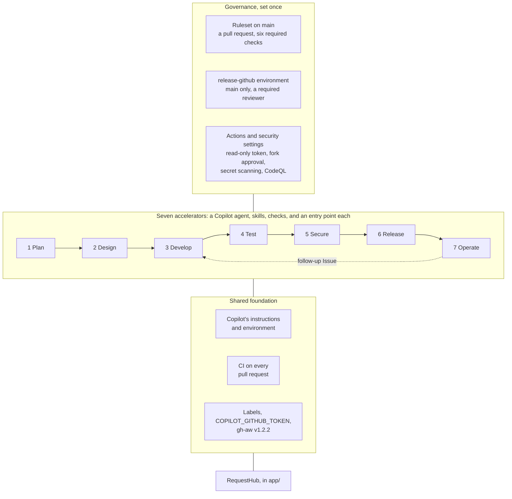

# AI-SDLC landing zone on GitHub

One repository where an application and all seven GitHub accelerators of [AI across the software development lifecycle](https://github.com/melabadi/adept-assessment-northstars) live together. The app is RequestHub, a small request-and-approval portal with synthetic data. Each SDLC phase, from Plan to Operate, has its Copilot custom agent, its skills, its deterministic checks, and its entry point: an issue form, a command, a label, or a workflow. What the accelerators share is set up once: Copilot's environment, CI, the labels, one token, and the governance that keeps a person at every decision. Each accelerator was installed with its own README's *Getting started*, in phase order, one pull request each, and one script checks that the whole landing zone is wired.



- **See it work:** [one release cycle through all seven phases](docs/see-it-work/README.md), run live on 17 November 2026: from stakeholder notes to a published release and a proven incident fix, with nine decisions made by a person, and every step's screenshots, links, timings, and AI credits.
- **Build your own:** [install the seven in your repository](#build-your-own-landing-zone), each with its README's commands, then the [one-time setup](#3-set-up-what-they-share-once) they share. Here the seven installs took 20 minutes 33 seconds, and the one-time setup about 5 more, apart from the token you create yourself.
- **Files to edit to tweak it:** [the landing zone's own files](#files-to-edit-to-tweak-it), and each accelerator's list.
- **Check it:** [`tools/check_landing_zone.py`](tools/check_landing_zone.py) reads the repository and reports, for every accelerator, whether it is installed, set up, and green: [48 passed, 0 failed](#the-wiring-check).
- **See how it was built:** [one pull request per accelerator](#how-this-landing-zone-was-built), each with what it copied, what it edited, and what it checked.

## Technologies used

| Technology | What it does here |
| --- | --- |
| [Copilot cloud agent](https://docs.github.com/en/copilot/concepts/copilot-surfaces/copilot-on-github) | Works on an Issue unattended, in a session on GitHub Actions, and opens a pull request: a brief, an ADR, a feature, a fix, a repair, a regression test |
| [Custom agents](https://docs.github.com/en/copilot/concepts/customizations/custom-agents) and [agent skills](https://docs.github.com/en/copilot/concepts/customizations/agent-skills) | Seven agents, one per phase (`plan-github` to `operate-github`), and 15 skills with their procedures and scripts |
| [GitHub Copilot CLI](https://docs.github.com/en/copilot/concepts/copilot-surfaces/copilot-cli) | Runs the same agents from a terminal |
| [Copilot code review](https://docs.github.com/en/copilot/how-tos/use-copilot-agents/use-code-review) | Reviews an ADR, a fix, or a security repair |
| [GitHub Agentic Workflows](https://github.com/github/gh-aw) | Four workflows that run Copilot on an event, with read-only access and only the writes they allow: the design review, the CI failure investigation, the release summary, and the incident triage |
| [GitHub Actions](https://docs.github.com/en/actions) | 21 workflows: CI, Copilot's environment, and each accelerator's checks, proofs, and release steps |
| Issues, with six [issue forms](https://docs.github.com/en/communities/using-templates-to-encourage-useful-issues-and-pull-requests/syntax-for-issue-forms) and 25 labels | Start the work: notes to refine, a design question, a feature, a defect, a remediation, an incident |
| [Rulesets](https://docs.github.com/en/repositories/configuring-branches-and-merges-in-your-repository/managing-rulesets/about-rulesets) | Require a pull request and six deterministic checks on `main` |
| [Environments](https://docs.github.com/en/actions/reference/workflows-and-actions/deployments-and-environments#deployment-protection-rules) and GitHub Container Registry | Gate the release approval on a person, and hold the release images |
| CodeQL, secret scanning, push protection, Dependabot alerts, private vulnerability reporting | Free on this public repository; CodeQL runs from the Secure accelerator's scan |

The stack is RequestHub's: a .NET 10 API with EF Core and xUnit v3 integration tests on PostgreSQL, a .NET worker, and a React and TypeScript web UI with Vitest and Playwright. Each accelerator's README names what to change for yours.

## What it does and how it works

### What a landing zone adds

Each accelerator works on its own. Installed together, they work on the same backlog, the same pull requests, and the same rules:

| | One accelerator at a time | The landing zone |
| --- | --- | --- |
| Setup | Each one-time setup in its own repository, and conflicts found when the second arrives | The shared pieces set up once: Copilot's environment, CI, labels, one token, one ruleset |
| Gates | Each phase's checks in isolation | One ruleset makes the bounds check, the app's tests, and the ADR and contract checks required on every pull request |
| Traceability | A requirement crosses tools and repositories | A transcript paragraph, its backlog Issue, the ADR, the feature's pull request, its tests, the release, and an incident's follow-up all link inside one repository |
| Decisions | Each team's rules | The same rule everywhere: Copilot proposes, checks decide whether it's complete, and a person decides |

### Where each phase starts, and who decides

| Phase | Start it with | Copilot does | What decides | A person |
| --- | --- | --- | --- | --- |
| [1. Plan](https://github.com/melabadi/adept-assessment-northstars/tree/main/solutions/01-plan-github) | The *Plan: refine requirements with Copilot* form, or `copilot --agent plan-github` with [`planning/refine-task.md`](planning/refine-task.md) | Drafts a brief and a backlog that cite [the notes](planning/inputs/) | *Validate the brief*: the schema, real citations, testable criteria | Applies `brief-approved`, which publishes the epic and its tasks as Issues |
| [2. Design](https://github.com/melabadi/adept-assessment-northstars/tree/main/solutions/02-design-github) | The *Design: architecture decision with Copilot* form, `/design-review` on an Issue or a pull request, or [`docs/architecture/adr-task.md`](docs/architecture/adr-task.md) | Answers `/design-review` with the [standards](docs/architecture/standards/) that apply; writes the ADR | *ADR checks* and *API contract compatibility*, required | Accepts the ADR by name, or rejects it |
| [3. Develop](https://github.com/melabadi/adept-assessment-northstars/tree/main/solutions/03-develop-github) | The *Develop: bounded feature for Copilot* form, assigned to Copilot with `develop-github` | Builds the feature and a test per acceptance criterion | *Feature stays within its bounds* and CI, required | Adds their own test, reviews, and merges |
| [4. Test](https://github.com/melabadi/adept-assessment-northstars/tree/main/solutions/04-test-github) | The *Test: defect to fix test-first with Copilot* form, assigned with `test-github` on a `lab/test-*` branch | Commits failing tests, then the fix; explains a red CI run | *Regression tests fail before the fix and pass after it* | Approves the fix |
| [5. Secure](https://github.com/melabadi/adept-assessment-northstars/tree/main/solutions/05-secure-github) | Copilot code review on a `lab/secure-*` pull request, then the *Secure: remediate* form, assigned with `secure-github` | Finds the injection; commits the regression, then the repair | The trusted replay, `secure-github-verify.yml`, and the CodeQL scan | Decides on the repair; the lab never merges |
| [6. Release](https://github.com/melabadi/adept-assessment-northstars/tree/main/solutions/06-release-github) | `gh workflow run release-github-candidate.yml -f version=1.0.0` | Summarizes the evidence for the approver | The candidate's test gate, smoke test, and checksums | The required reviewer approves the `release-github` deployment |
| [7. Operate](https://github.com/melabadi/adept-assessment-northstars/tree/main/solutions/07-operate-github) | The *Operate: report an incident* form, or [the Copilot CLI runbook](docs/runbooks/incident-triage.md) | Triages the incident into one follow-up; writes the regression test and the fix | *Prove the regression test*: it fails without the fix | Files the triage, assigns the follow-up, reviews |

Each phase name links to the accelerator's README: how it works, a recorded run with its screenshots and links, and what it measured.

### What the accelerators share

- **Labels.** `ai-sdlc` and a `phase:<phase>` label on every form, and each accelerator's own: `brief-approved`; `adr-needed` and `standards-conflict`; three `ci:` labels; `incident`, `incident-followup`, four `severity:`, five `area:`, and `needs-info`.
- **Copilot's environment.** [`copilot-setup-steps.yml`](.github/workflows/copilot-setup-steps.yml) installs .NET, Node.js, Playwright, Python, and Plan's one package, and starts PostgreSQL, for every agent that runs tests in its session.
- **Skills.** `contract-impact` comes with Design, Develop, and Test, and `regression-validation` with Develop and Test: the copies are identical.
- **One token.** The four agentic workflows share `COPILOT_GITHUB_TOKEN`; everything else works without it.
- **Every lock file records every agent.** gh-aw v1.2.2 writes each custom agent's name and tools into each compiled `.lock.yml`, and each accelerator's checks compare the lock file with a fresh compile. So whenever an agent is added or its front matter changes, all four are compiled again: `gh aw compile --strict --validate`.
- **Unit tests.** Test, Release, and Operate keep their scripts' unit tests in [`tests/`](tests/), and each one's checks run all of them.

### Governance

| Setting | Value | Why |
| --- | --- | --- |
| Ruleset *Protect main* | A pull request before every merge, no deletion, no force push, no bypass; requires *Feature stays within its bounds*, *API and worker tests*, *Web UI checks*, *Browser tests*, *ADR checks*, and *API contract compatibility* | Develop's one-time setup and Design's optional gate. Each required check runs on every pull request, so none stays pending |
| Environment `release-github` | Deployments from `main` only; a required reviewer; administrators can't bypass it | The release approval waits for a person |
| Actions | The workflow token reads by default and can't approve pull requests; runs from every external contributor's fork wait for approval | What the source repository asks of [a public copy](https://github.com/melabadi/adept-assessment-northstars/blob/main/CONTRIBUTING.md#settings-for-a-public-copy) |
| Security | Secret scanning, push protection, Dependabot alerts, and private vulnerability reporting; CodeQL from Secure's scan on every push to `main`, with default setup off | Free on a public repository |
| Copilot code review | **Block reviews requested with an external Copilot license**: in a personal repository, only the owner and direct collaborators can request a review | Outsiders can't start Copilot reviews here, even with their own Copilot license |

On a public repository, outsiders start nothing that costs money, uses a token, or writes: each accelerator checks who wrote the text before Copilot reads it, and the agentic workflows keep gh-aw's protections. Each accelerator's README says what an outside contribution can and can't trigger.

## What's in the repository

```text
app/                                RequestHub: the API, the worker, the web UI, the integration tests, the contract, Bicep
planning/                           1 Plan: workshop notes and policies (inputs/), Copilot's task, the publisher's tests
docs/
├── architecture/                   2 Design: the approved standards, the reviewed brief, Copilot CLI's task; ADRs go in adr/
├── runbooks/incident-triage.md     7 Operate: the triage with Copilot CLI, without the token
└── see-it-work/                    the recorded end-to-end run: one release cycle through the seven phases, with screenshots
tests/                              unit tests of the Test, Release, and Operate scripts, with JUnit fixtures
solutions/05-secure-github/         5 Secure: the lab patch, the regression reference, the replay setup, their tests
tools/check_landing_zone.py         the wiring check
.github/
├── copilot-instructions.md         the repository's instructions for Copilot, with this map
├── agents/                         seven custom agents: plan-github, design-github, ... operate-github
├── skills/                         15 skills: procedures and the scripts the agents and the workflows run
├── workflows/                      ci.yml, copilot-setup-steps.yml, and each accelerator's workflows (*.md and *.lock.yml: agentic)
├── ISSUE_TEMPLATE/                 six forms, 01-plan-github-refine.yml to 07-operate-github-incident.yml
├── instructions/                   what Copilot code review checks in an ADR
├── codeql/extensions/              CodeQL models of RequestHub's API input
├── aw/actions-lock.json            the action versions gh-aw pinned when it compiled
└── LICENSE-ai-sdlc                 the licence the accelerators' files carry
```

## Build your own landing zone

Start from your repository, with your app, its CI, and your `.github/copilot-instructions.md`. The accelerators are written for RequestHub's stack: each README's *Files to edit to tweak it* says what to change for yours.

### 1. Check your tools

The source repository's [Before you start](https://github.com/melabadi/adept-assessment-northstars#before-you-start) lists them: GitHub CLI signed in with the `workflow` scope, PowerShell 7.4 or later, Python 3.12 or later, Copilot CLI, and gh-aw v1.2.2 (`gh extension install github/gh-aw --pin v1.2.2`). You need a paid Copilot plan with the Copilot cloud agent allowed in the repository, and admin rights for the ruleset and the environment.

### 2. Install the seven in phase order

Follow each README's *Getting started*, one pull request each, and merge it before the next. The steps below are what this landing zone needed beyond the copy, on RequestHub:

| Accelerator | Its *Getting started* | What this landing zone did beyond the copy |
| --- | --- | --- |
| 01-plan-github | [Getting started](https://github.com/melabadi/adept-assessment-northstars/tree/main/solutions/01-plan-github#getting-started) | The README's rewrite pointed 11 files at `planning/`. `copilot-setup-steps.yml` installs `planning/requirements.txt`. |
| 02-design-github | [Getting started](https://github.com/melabadi/adept-assessment-northstars/tree/main/solutions/02-design-github#getting-started) | RequestHub's standards and brief went to `docs/architecture/standards/` and `inputs/`, and the copied files point there. The checks keep the lock-file job only. `design-github-review.yml` lost its `paths` filter, so its two checks can be required. The first compile wrote `.gitattributes`: commit it. |
| 03-develop-github | [Getting started](https://github.com/melabadi/adept-assessment-northstars/tree/main/solutions/03-develop-github#getting-started) | Nothing to edit. Compile every agentic workflow again: this one adds an agent. |
| 04-test-github | [Getting started](https://github.com/melabadi/adept-assessment-northstars/tree/main/solutions/04-test-github#getting-started) | `test-github-checks.yml` watches and runs `tests/`. |
| 05-secure-github | [Getting started](https://github.com/melabadi/adept-assessment-northstars/tree/main/solutions/05-secure-github#getting-started) | The checks drop the source repository's mirror check. The posture review instructions stay out: they review the Microsoft counterpart's Bicep fix. |
| 06-release-github | [Getting started](https://github.com/melabadi/adept-assessment-northstars/tree/main/solutions/06-release-github#getting-started) | `release-github-checks.yml` watches and runs `tests/`. The release notes link the accelerator's documentation through `SOLUTION_URL` in `release_evidence.py`. The images go under the repository's own path, `ghcr.io/<owner>/<repository>/requesthub-*`: the source repository's releases already own `ghcr.io/<owner>/requesthub-*` in the same account, and the registry refused this repository's first push to them. |
| 07-operate-github | [Getting started](https://github.com/melabadi/adept-assessment-northstars/tree/main/solutions/07-operate-github#getting-started) | Option B's Copilot CLI command lives in [`docs/runbooks/incident-triage.md`](docs/runbooks/incident-triage.md), and the unit tests read it there. `operate-github-checks.yml` watches it and runs `tests/`. |

From 03-develop-github on, every accelerator adds a custom agent, and every lock file records every agent. Compile all the agentic workflows again before you commit, or the lock-file checks of the accelerators already installed fail on its pull request:

```powershell
gh aw compile --strict --validate
git add .github/workflows/*.lock.yml
```

### 3. Set up what they share, once

Each README creates its own labels as it goes. Once all seven are merged, from the root of your repository:

```powershell
# CI reports on every pull request, so the ruleset can require its jobs: remove the paths filter under pull_request in
# .github/workflows/ci.yml, in a pull request of its own, before the ruleset.

# The ruleset: a pull request before every merge, and the six checks that run on every pull request.
$checks = 'Feature stays within its bounds', 'API and worker tests', 'Web UI checks', 'Browser tests', 'ADR checks', 'API contract compatibility'
@{
  name = 'Protect main'; target = 'branch'; enforcement = 'active'; bypass_actors = @()
  conditions = @{ ref_name = @{ include = @('~DEFAULT_BRANCH'); exclude = @() } }
  rules = @(
    @{ type = 'deletion' }, @{ type = 'non_fast_forward' },
    @{ type = 'pull_request'; parameters = @{ required_approving_review_count = 0; dismiss_stale_reviews_on_push = $false; require_code_owner_review = $false; require_last_push_approval = $false; required_review_thread_resolution = $false; allowed_merge_methods = @('squash') } },
    @{ type = 'required_status_checks'; parameters = @{ strict_required_status_checks_policy = $false; do_not_enforce_on_create = $false; required_status_checks = @($checks | ForEach-Object { @{ context = $_; integration_id = 15368 } }) } }
  )
} | ConvertTo-Json -Depth 8 | gh api -X POST 'repos/{owner}/{repo}/rulesets' --input - --jq .name

# The release environment, as 06-release-github's one-time setup creates it, with you as its required reviewer.
gh api -X PUT 'repos/{owner}/{repo}/environments/release-github' -F 'deployment_branch_policy[protected_branches]=false' -F 'deployment_branch_policy[custom_branch_policies]=true' --silent
gh api -X POST 'repos/{owner}/{repo}/environments/release-github/deployment-branch-policies' -f name=main -f type=branch --silent
"{""reviewers"":[{""type"":""User"",""id"":$(gh api user --jq .id)}],""can_admins_bypass"":false,""deployment_branch_policy"":{""protected_branches"":false,""custom_branch_policies"":true}}" |
  gh api -X PUT 'repos/{owner}/{repo}/environments/release-github' --input - --jq '[.protection_rules[].type]'

# Actions and security settings for a public repository.
gh api -X PUT 'repos/{owner}/{repo}/actions/permissions/workflow' -f default_workflow_permissions=read -F can_approve_pull_request_reviews=false
gh api -X PUT 'repos/{owner}/{repo}/actions/permissions/fork-pr-contributor-approval' -f approval_policy=all_external_contributors
'{"security_and_analysis":{"secret_scanning":{"status":"enabled"},"secret_scanning_push_protection":{"status":"enabled"}}}' | gh api -X PATCH 'repos/{owner}/{repo}' --input - --silent
gh api -X PUT 'repos/{owner}/{repo}/vulnerability-alerts'
gh api -X PUT 'repos/{owner}/{repo}/private-vulnerability-reporting'

# Secure's nightly replay of a reference repair: deterministic, no Copilot. Then run it once.
python solutions/05-secure-github/replay_setup.py
gh workflow run secure-github-verify.yml --ref main

# The four agentic workflows' token: a fine-grained personal access token with Copilot Requests: Read only.
gh secret set COPILOT_GITHUB_TOKEN    # paste the token when prompted
```

Create the token from [this link](https://github.com/settings/personal-access-tokens/new?name=COPILOT_GITHUB_TOKEN_LANDING_ZONE&description=GitHub+Agentic+Workflows+-+Copilot+engine+authentication&expires_in=90&user_copilot_requests=read): it opens the form with your account as the resource owner, read-only access to public repositories, a 90-day expiry, and one permission, **Copilot Requests: Read**. Token names are unique in an account, so rename it if you have one by that name. Its owner's Copilot plan pays for the agentic workflows' runs. Then turn on **Block reviews requested with an external Copilot license** under **Settings** → **Copilot** → **Code review**: in a personal repository, only the owner and direct collaborators can then request a review.

### 4. Check the wiring

```powershell
python tools/check_landing_zone.py
```

Copy [`tools/check_landing_zone.py`](tools/check_landing_zone.py), and change its lists if your folders or your required checks differ. It ends with `0 failed` when every accelerator is installed, set up, and green, as in [the wiring check](#the-wiring-check) below.

## Files to edit to tweak it

Each accelerator's README lists its own files under *Files to edit to tweak it*. These shape the landing zone as a whole:

| File | What it decides |
| --- | --- |
| [`.github/copilot-instructions.md`](.github/copilot-instructions.md) | What every agent knows about the repository: the map, the build and test commands, and the rules no change may break |
| [`.github/workflows/copilot-setup-steps.yml`](.github/workflows/copilot-setup-steps.yml) | The cloud agent's toolchain and services, for every agent that runs tests |
| [`.github/workflows/ci.yml`](.github/workflows/ci.yml) | The tests the ruleset requires on every pull request |
| The ruleset *Protect main* (**Settings** → **Rules**) | Which checks block a merge |
| [`tools/check_landing_zone.py`](tools/check_landing_zone.py) | `ACCELERATORS`, `REQUIRED_CHECKS`, and `FOUNDATION_FILES`: what the wiring check expects |

## The wiring check

[`tools/check_landing_zone.py`](tools/check_landing_zone.py) reads the repository through GitHub CLI and changes nothing. For the shared foundation, each accelerator, and the governance settings, it checks the files on `main`, the workflows GitHub registered, the latest result of each deterministic check, the labels, the environment, the variable, the secret, the ruleset, and the security settings. Run it signed in as an administrator: secrets, environments, and Actions settings are visible only to them. It exits with 1 when a line fails.

Its run on 17 November 2026, once the one-time setup was done, ended with `48 passed, 0 warnings, 0 failed`:

<details>
<summary>The full output</summary>

```text
Landing zone check: melabadi/ai-sdlc-landing-zone, main at d081230, 2026-11-17 12:38 UTC

Shared foundation
  PASS  Copilot's instructions, CI, Copilot setup steps, and the licence  (4 on main)
  PASS  latest run of ci.yml  (success, push run 43974614001 on main at 2026-11-16T22:57:29Z)
  PASS  latest run of copilot-setup-steps.yml  (success, push run 43970873571 on main at 2026-11-16T22:32:28Z)
  PASS  labels ai-sdlc
  PASS  the Copilot cloud agent can be assigned Issues
  PASS  secret COPILOT_GITHUB_TOKEN, for the four agentic workflows

01-plan-github (Plan)
  PASS  agent plan-github, skills requirements-traceability, backlog-publish, issue form  (7 on main)
  PASS  2 workflows registered and active  (plan-github-brief.yml, plan-github-checks.yml)
  PASS  labels phase:plan, brief-approved
  PASS  latest run of plan-github-checks.yml  (success, pull_request run 43970662599 on add-plan-github at 2026-11-16T22:30:21Z)

02-design-github (Design)
  PASS  agent design-github, skills architecture-decision, contract-impact, issue form  (7 on main)
  PASS  3 workflows registered and active  (design-github-review.yml, design-github-agentic-review.lock.yml, design-github-checks.yml)
  PASS  labels phase:design, adr-needed, standards-conflict
  PASS  latest run of design-github-review.yml  (success, pull_request run 43976137963 on readme-diagram-edge at 2026-11-16T23:05:38Z)
  PASS  latest run of design-github-checks.yml  (success, pull_request run 43973635391 on add-operate-github at 2026-11-16T22:49:24Z)

03-develop-github (Develop)
  PASS  agent develop-github, skills bounded-feature, regression-validation, issue form  (4 on main)
  PASS  1 workflow registered and active  (develop-github-bounds.yml)
  PASS  labels phase:develop
  PASS  latest run of develop-github-bounds.yml  (success, pull_request run 43976138183 on readme-diagram-edge at 2026-11-16T23:05:37Z)

04-test-github (Test)
  PASS  agent test-github, skills failure-reproduction, review-evidence, ci-investigation, issue form  (7 on main)
  PASS  3 workflows registered and active  (test-github-proof.yml, test-github-ci-investigation.lock.yml, test-github-checks.yml)
  PASS  labels phase:test, bug, ci:defect-reproduced, ci:regression, ci:infrastructure
  PASS  latest run of test-github-checks.yml  (success, pull_request run 43973635442 on add-operate-github at 2026-11-16T22:49:22Z)

05-secure-github (Secure)
  PASS  agent secure-github, skills finding-triage, verified-remediation, issue form  (6 on main)
  PASS  3 workflows registered and active  (secure-github-checks.yml, secure-github-verify.yml, secure-github-scan.yml)
  PASS  labels phase:secure
  PASS  latest run of secure-github-checks.yml  (success, push run 43973048049 on main at 2026-11-16T22:45:26Z)
  PASS  latest run of secure-github-scan.yml  (success, push run 43976502881 on main at 2026-11-16T23:09:43Z)
  PASS  variable SECURE_REPLAY_PR, the nightly replay's repair  (pull request #9)
  PASS  latest run of secure-github-verify.yml  (success, schedule run 44021855439 on main at 2026-11-17T05:08:52Z)

06-release-github (Release)
  PASS  agent release-github, skills release-evidence, workflow-investigation  (4 on main)
  PASS  4 workflows registered and active  (release-github-candidate.yml, release-github-approve.yml, release-github-summary.lock.yml, release-github-checks.yml)
  PASS  latest run of release-github-checks.yml  (success, pull_request run 43973635507 on add-operate-github at 2026-11-16T22:49:17Z)
  PASS  environment release-github: only the default branch, with a required reviewer  (rules ['branch_policy', 'required_reviewers'], branches ['main'])

07-operate-github (Operate)
  PASS  agent operate-github, skills incident-evidence, regression-followup, issue form  (6 on main)
  PASS  3 workflows registered and active  (operate-github-incident-triage.lock.yml, operate-github-regression-proof.yml, operate-github-checks.yml)
  PASS  labels phase:operate, incident, incident-followup, severity:1, severity:2, severity:3, severity:4, area:worker, area:api, area:web, area:database, area:infrastructure, needs-info
  PASS  latest run of operate-github-checks.yml  (success, pull_request run 43973635535 on add-operate-github at 2026-11-16T22:49:20Z)

Governance
  PASS  ruleset on main: a pull request before every merge
  PASS  ruleset on main: no deletion
  PASS  ruleset on main: no force push
  PASS  ruleset on main: 6 required checks  (Feature stays within its bounds, API and worker tests, Web UI checks, Browser tests, ADR checks, API contract compatibility)
  PASS  Actions token read-only by default, and unable to approve pull requests
  PASS  runs from every external contributor's fork wait for approval  (all_external_contributors)
  PASS  secret scanning
  PASS  push protection
  PASS  private vulnerability reporting
  PASS  Dependabot alerts

48 passed, 0 warnings, 0 failed
```

</details>

Without `COPILOT_GITHUB_TOKEN`, its line is a warning, not a failure: only the four agentic workflows need the token.

## How this landing zone was built

On 16 November 2026, a GitHub Copilot agent session working for the repository owner ran each README's commands, from ai-sdlc commit [`6a585af`](https://github.com/melabadi/adept-assessment-northstars/commit/6a585af1a2ceb46e072ed4a1ebe549e70dd04531). Each pull request says what it copied, what it edited, what it checked locally, and what it set up, and every check passed before it merged.

| Pull request | What it added |
| --- | --- |
| The first commit | RequestHub: the app, its CI, Copilot's environment, and Copilot's instructions |
| [#1](https://github.com/melabadi/ai-sdlc-landing-zone/pull/1) to [#7](https://github.com/melabadi/ai-sdlc-landing-zone/pull/7) | The seven accelerators, in phase order: from the first pull request's creation (22:30:06 UTC) to the seventh's merge (22:50:39), 20 minutes 33 seconds |
| [#8](https://github.com/melabadi/ai-sdlc-landing-zone/pull/8) | CI on every pull request, so the ruleset can require it; the ruleset followed |
| [#9](https://github.com/melabadi/ai-sdlc-landing-zone/pull/9) | Secure's reference repair for the nightly replay, closed by `replay_setup.py`: it is never merged |
| [#10](https://github.com/melabadi/ai-sdlc-landing-zone/pull/10) and [#11](https://github.com/melabadi/ai-sdlc-landing-zone/pull/11) | This README, the wiring check, and the repository map in Copilot's instructions |

On 17 November, the same session finished the one-time setup in the owner's browser. It created `COPILOT_GITHUB_TOKEN_LANDING_ZONE`, a fine-grained token with Copilot Requests: Read only, which expires on 15 February 2027, stored it as `COPILOT_GITHUB_TOKEN`, and turned on *Block reviews requested with an external Copilot license*. When the token expires, the four agentic workflows fail until you store a new one; everything else keeps working.

The same day, the owner ran one release cycle through all seven phases, live, with this landing zone: [See it work](docs/see-it-work/README.md) records every step, from Issue [#13](https://github.com/melabadi/ai-sdlc-landing-zone/issues/13) to pull request [#34](https://github.com/melabadi/ai-sdlc-landing-zone/pull/34).

## Try an accelerator here

Each README's *Use it the first time* applies here, with the paths above. The feature, the defect lab, and the sample incident of the recorded runs stayed in the source repository, as the copy steps leave them: use them for a first run. The [end-to-end run](docs/see-it-work/README.md) used them once, so `main` now has their results: the brief, ADR 0001, the routing confirmation, and the timeout fix. Its [Run it again](docs/see-it-work/README.md#run-it-again) says which base branch to give Copilot to repeat a phase.

- **Plan:** the notes are in [`planning/inputs/`](planning/inputs/). On a new branch, run `copilot --agent plan-github --allow-all-tools -p (Get-Content planning/refine-task.md -Raw)`, open the pull request, then apply `brief-approved`.
- **Design:** on a new branch, run `copilot --agent design-github --allow-all-tools -p (Get-Content docs/architecture/adr-task.md -Raw)`, or comment `/design-review` on an Issue.
- **Develop:** file the feature from [`feature-issue.md`](https://github.com/melabadi/adept-assessment-northstars/blob/main/solutions/03-develop-github/feature-issue.md) with the *Develop* form, and assign it to Copilot with `develop-github`.
- **Test:** the lab patch, the scenarios, and the defect report are in the source's [`solutions/04-test-github/`](https://github.com/melabadi/adept-assessment-northstars/tree/main/solutions/04-test-github): apply the patch on a `lab/test-<run>` branch, file the defect, and assign it with `test-github` and that branch as the base.
- **Secure:** the lab patch and the regression are in [`solutions/05-secure-github/`](solutions/05-secure-github/), where its README's *Try it first* expects them.
- **Release:** `gh workflow run release-github-candidate.yml -f version=1.0.0`, then approve the draft as the environment's reviewer.
- **Operate:** file [the sample incident](https://github.com/melabadi/adept-assessment-northstars/blob/main/solutions/07-operate-github/incidents/inc-2041-notification-backlog.md) with the *Operate* form, or triage it with [the Copilot CLI runbook](docs/runbooks/incident-triage.md).

Each accelerator's README names the metric to track when you adopt it, from the lead time from a request to a published backlog (Plan) to the time from an incident to a proven regression test (Operate).

## Take updates

Every install copied from commit `6a585af`. To see what changed in an accelerator since then:

```powershell
$src = Join-Path ([IO.Path]::GetTempPath()) 'ai-sdlc-updates'
git clone --quiet https://github.com/melabadi/adept-assessment-northstars.git $src
git -C $src log --oneline 6a585af..main -- solutions/03-develop-github
git -C $src diff --stat 6a585af main -- solutions/03-develop-github
Remove-Item -Recurse -Force $src
```

Bring what you want into your copy by hand, compile the agentic workflows again if an agent or a workflow's source changed, and run the wiring check.

## License

The [MIT License with the Commons Clause](LICENSE), the licence of the repository that RequestHub and the accelerators come from; the accelerators' files also carry it as [`.github/LICENSE-ai-sdlc`](.github/LICENSE-ai-sdlc). RequestHub is described in [app/README.md](app/README.md). All its people, requests, and policies are synthetic.
