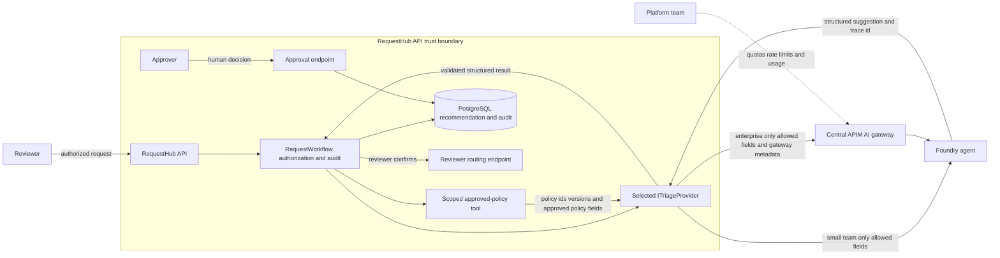
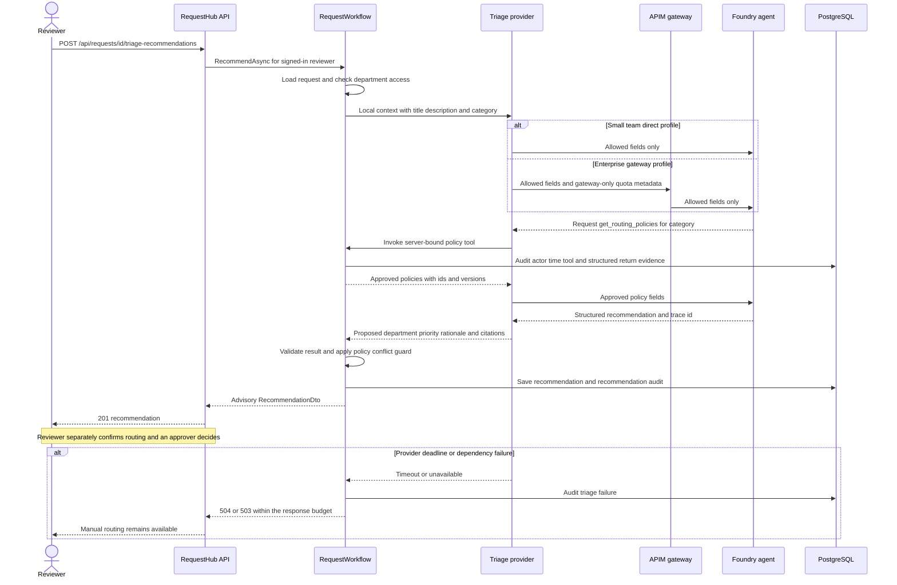

# ADR 0001: Live AI triage provider

- **Status:** Proposed
- **Date:** 2026-11-17
- **Deciders:** to be named in the design review (people, never an agent)
- **Related:** `docs/architecture/inputs/reviewed-brief.md`

## Context

RequestHub needs an advisory department and priority recommendation for requests a reviewer can see. A person still confirms routing, and only an approver decides. BR-3 limits AI input to request title, description, category, and approved routing policies. BR-4 requires an audit of recommendations and assistant tool calls. BR-6 sets an 8-second p95 target. English and French are required.

The app already has `ITriageProvider`, a sample provider, and a live `FoundryTriageProvider` selected in `app/src/RequestHub.Api/Program.cs`. `RequestWorkflow.RecommendAsync` authorizes staff for the request's department, sets a 45-second default timeout, validates output, applies a policy-conflict guard, saves the recommendation and audit, and returns a user-facing error on failure. Its scoped tools are server-bound to the authorized request. Routing remains a separate reviewer action and approval remains separate.

The current live provider does not yet satisfy BR-3: its prompt includes requestId, category, and department names, and its request tool returns an id, current department, and priority as well as the allowed fields. Its policy tool returns approved policy content. Tool audit records currently include actor, time, tool name, request id, and outcome, but not returned evidence. The design below must narrow outbound data and improve structured audit evidence before enabling live AI.

`app/infra/requesthub.bicep` provisions Container Apps, a user-assigned app identity, monitoring, and private PostgreSQL. There is no AI gateway in this module. The current Foundry provider uses an Azure credential and response client; its trace id is persisted with the recommendation.

## Decision drivers

- Keep model output advisory and tools narrow, read-only, scoped, and audited (STD-AI-001 v1.0).
- Send only permitted request fields and approved policies, use workload identity, and do not persist raw free-text prompts or completions (STD-SEC-001 v2.0, STD-SEC-002 v1.1).
- Extend the existing service and interface before adding another deployable (STD-ARCH-001 v1.0).
- Keep dependency calls observable and make timeout or outage visible without blocking manual routing (STD-OBS-001 v1.2).
- Meet the 8-second p95 requirement (BR-6) and provide English and French (BR-7).
- Apply the small-team operating budget and retention (STD-OPS-001 v1.0, STD-DATA-002 v1.0).
- Apply the enterprise gateway, traceability, evaluation, and retention requirements (STD-OPS-002 v2.0, STD-AI-002 v1.0, STD-DATA-001 v1.0).
- Preserve the current public contract unless an additive change is needed (STD-API-001 v1.0).

## Options considered

| Option | How it works here | Small team | Enterprise | Main trade-off |
| --- | --- | --- | --- | --- |
| A. In-process provider calling Foundry directly | Select a live implementation of `ITriageProvider` in the existing API. It calls a managed Foundry endpoint from the API container. | **Prefer.** No new app deployable or gateway to operate. Fits STD-ARCH-001 v1.0 and STD-OPS-001 v1.0. | **Reject for production.** Direct model calls violate STD-OPS-002 v2.0 and do not provide its central per-department controls. | Lowest deployment complexity and hop count, but no central quota or usage enforcement. |
| B. In-process provider calling Foundry through the central APIM AI gateway | Keep triage in the API and use a gateway-backed provider/adapter. The gateway applies quotas, rate limits, and usage reporting before forwarding to Foundry. | **Use only if an existing platform team operates it.** Otherwise it adds an operated gateway dependency contrary to STD-OPS-001 v1.0. | **Prefer.** It meets STD-OPS-002 v2.0 while retaining the existing API and extension point under STD-ARCH-001 v1.0. | Adds a hop and requires a gateway-compatible Foundry/tool-call protocol, but provides enterprise controls without a new RequestHub deployable. |

Both options require the same data minimization, identity, authorization, human-decision boundary, audit, timeout, language, and retention safeguards. Neither may send attachments or personal data, and neither may apply a recommendation automatically.

### Option A: In-process provider calling Foundry directly

`Program.cs` already selects `FoundryTriageProvider` by configuration and replaces the sample implementation. This option keeps that deployment shape and uses the API's workload identity. Before use, narrow the request and tool payloads exactly as described in the Decision and Architecture sections. It is the small-team recommendation because it adds a managed AI dependency, not a separate RequestHub runtime component. It is not an enterprise production option because direct calls are prohibited by STD-OPS-002 v2.0.

### Option B: In-process provider calling Foundry through APIM

The API keeps authorization, local tool execution, validation, audit, and persistence. A gateway-backed `ITriageProvider` implementation or adapter sends allowed content through the central APIM AI gateway. APIM enforces department quotas, rate limits, and usage reporting. This is the enterprise recommendation and adds no RequestHub service. The existing `ProjectResponsesClient` calls Foundry directly, so gateway protocol compatibility must be proven before implementation. For a small team, use this only when the gateway is already operated, consistent with STD-OPS-001 v1.0.

## Decision

Recommend Option A for the small-team profile and Option B for the enterprise profile. The profile difference is operational, not a different approval or data policy: a small team avoids an additional gateway dependency, while enterprise must use its centrally operated gateway for controls and reporting. In either profile, keep the provider inside the existing API and retain the current endpoint contract.

Do not enable the current live provider unchanged. The provider must send the model only title, description, and category. It may retrieve approved policy fields through one narrowly scoped, server-bound `get_routing_policies(category)` tool. Do not expose `get_request` to the model, and do not send request ids, department names, current department, or current priority. Approved policy fields may include the policy id and version, type, title, text, route target, and threshold. The API binds the tool to the request already authorized by `RequestWorkflow`, uses that request only to associate the audit event, and never accepts a model-supplied request id or arbitrary record selector. It returns policies only from the approved in-process profile.

Keep the workflow's output validation and policy-conflict guard. Store the structured recommendation, cited policy ids and versions, provider trace id, and recommendation audit. A reviewer must separately confirm routing through the routing endpoint. An approver alone uses the decision endpoint. Model output and prompt-injected request text cannot approve, reject, or read another request.

Set a bounded provider deadline within the 8-second end-to-end budget. A six-second provider deadline is the initial budget to validate: it leaves up to two seconds for the user-facing unavailable response required by STD-OBS-001 v1.2. Tune only from measured end-to-end p95 results. Manual routing must continue if the provider times out or is unavailable.

## Architecture

The request's title, description, category, and approved policy content are the only model payload. Gateway quota metadata is control-plane metadata derived by the API from the authorized request; it must not be forwarded to the model. The exact enterprise metadata and its compatibility with BR-3 remain open for review.

## API impact

## API contract impact (requesthub.v1 vs origin/main)
**Compatible**: additive-only changes are allowed within the current contract version (STD-API-001).

- Breaking changes: 0
- Additive changes: 0

No contract changes.

The design relies on these existing `app/contracts/openapi.json` operations and fields:

- `POST /api/requests/{id}/triage-recommendations` returns `RecommendationDto`: `suggestedDepartmentId`, `suggestedPriority`, `rationale`, `policyRefs` (`policyId`, `version`), `confidence`, `needsHumanReview`, `providerTraceId`, plus provider, status, creator, and timestamp metadata. Its 403, 404, 409, 502, 503, and 504 responses support authorization and unavailable/error states.
- `GET /api/requests/{id}` provides the authorized request's `title`, `description`, `category`, and caller permissions. The server uses these fields locally and sends only the allowed subset to the model.
- `GET /api/policies` exposes approved policy identifiers and versions used to render citations.
- `GET /api/requests/{id}/triage-recommendations` retrieves persisted recommendations.
- `PUT /api/requests/{id}/routing` with `departmentId` and `reason` is the separate reviewer routing action.
- `POST /api/requests/{id}/decisions` is the separate human approval or rejection action.
- `GET /api/requests/{id}/history` exposes the request audit history.

No API change is required. If a later decision requires a locale or gateway-control field in the public API, add it as an optional field or new endpoint under STD-API-001 v1.0. Do not rename, remove, or tighten existing contract fields.

## Threat model checklist

- [ ] Before sending any request to the model, enforce an allowlist of title, description, category, and approved policy fields. Do not send request ids, department names, current department, priority, attachments, comments, or personal data (STD-SEC-002 v1.1).
- [ ] Authenticate app-to-Foundry or app-to-APIM with the API workload identity. Store no API keys or shared secrets and disable key authentication where supported (STD-SEC-001 v2.0).
- [ ] Expose only `get_routing_policies(category)` to the model. The API binds it to the authorized workflow context, reads only approved policies, records the actor and time, and does not allow arbitrary request ids or writes (STD-AI-001 v1.0).
- [ ] Record tool return evidence as structured identifiers and outcome, such as policy ids and versions, not full user text or the raw tool response. Confirm that this satisfies BR-4.
- [ ] Validate department, priority, cited policies, confidence, rationale, and approval claims. A policy conflict requires human review. Prompt injection cannot approve or reject or cause a read of another request (STD-AI-001 v1.0).
- [ ] Do not persist raw prompts or completions containing user free text. Persist only the validated structured result and identifiers, subject to the logging conflict below (STD-SEC-002 v1.1).
- [ ] Emit OpenTelemetry spans and outcome/duration metrics without request text. Persist the provider response id and correlate it with the request (STD-OBS-001 v1.2, STD-AI-002 v1.0 for enterprise).
- [ ] On timeout or provider failure, show an unavailable state within two seconds of timeout and leave manual routing usable (STD-OBS-001 v1.2).
- [ ] For enterprise, verify APIM applies department quotas, rate limits, and usage reporting. Ensure any quota metadata is server-derived and is not forwarded to the model (STD-OPS-002 v2.0).
- [ ] Delete recommendation and AI audit records at the profile retention limit while retaining business decisions for seven years (STD-DATA-001 v1.0, STD-DATA-002 v1.0).

## Consequences

- Both profiles use the existing API runtime, authorization boundary, recommendation persistence, and human routing/decision endpoints.
- The provider must be changed before deployment to remove unapproved fields and its request-reading tool. This is required even though the extension point and endpoints already exist.
- The six-second initial provider budget is a target to verify, not a guarantee. A slow provider can yield an unavailable recommendation while manual routing continues.
- Enterprise gains central usage controls but incurs gateway latency and platform coordination. Small team avoids that dependency.
- English and French recommendation language and the selected locale source need a product decision because the recommendation endpoint has no locale field.
- Small-team recommendations are retained 90 days. Enterprise recommendations and their audit entries are retained 13 months. Business decisions retain the seven-year rule.

## Implementation tasks

1. **API/core engineer:** Narrow the provider serialization and tool schema to the exact BR-3 allowlist. Remove the model-facing request-read tool and all outbound request ids, department names, current department, and current priority. Keep policy-tool access server-bound to the already-authorized request. **Acceptance:** deterministic tests inspect the outbound prompt/tool payload and prove only title, description, category, and approved policy fields leave the API, including when a tool request supplies an arbitrary id.
2. **API/core engineer:** Add structured audit return evidence for each assistant tool call and recommendation, including actor, time, tool, outcome, and returned policy identifiers/versions or recommendation identifiers. Do not store raw prompt, completion, or free-text tool output. **Acceptance:** tests verify those audit fields and prove request text, prompt, completion, and raw tool response are absent.
3. **Platform engineer:** Configure small-team direct Foundry access and enterprise APIM-only access using workload identity. Confirm whether APIM supports the Foundry response and function-call protocol. Configure enterprise department quotas, rate limits, usage reporting, and server-derived control metadata without forwarding it to the model. **Acceptance:** deployment evidence shows successful identity auth, observed quota enforcement, and no direct production model route for enterprise.
4. **API/SRE engineer:** Set a bounded provider timeout within the 8-second response budget and add dependency spans, duration/outcome metrics, and failure handling. **Acceptance:** measured p95 is at most 8 seconds, and a forced timeout or outage produces a visible unavailable response within two seconds after timeout while routing remains usable.
5. **Data/platform owner:** Implement and verify profile-specific deletion of AI recommendations and audit entries after 90 days for small team or 13 months for enterprise, without deleting seven-year business decisions. **Acceptance:** retention tests prove each expiry and decision preservation. For enterprise, attach a versioned evaluation dataset with at least ten labeled cases including adversarial cases and results to release evidence (STD-AI-002 v1.0).
6. **Product/localization owner:** Choose caller locale behavior and provide English and French recommendation output without adding a required API field. **Acceptance:** API/UI scenarios verify both languages and identify the locale source.

## Open questions

1. **Direct standards conflict:** STD-OBS-002 v1.0 requires full prompt and completion logging for 30 days. STD-SEC-002 v1.1 prohibits persisting raw prompts or completions containing user free text and permits only structured results and identifiers. The live prompt contains request text, so both cannot be followed as written. A person must decide which standard to amend or whether a formally approved exception is appropriate. This ADR does not resolve the conflict.
2. **Audit detail:** BR-4 says to audit what each tool call returned. The proposed evidence is structured and redacted, such as policy ids and versions, rather than raw tool output. No standard defines the required audit payload. Does this satisfy BR-4, or must the requirement or standard be clarified without persisting user free text?
3. **Enterprise quota metadata:** Per-department APIM enforcement may need a department key. The API can derive it from its authorized request context, but BR-3 says only specified fields may be sent to the AI service. Does gateway-only control metadata satisfy that restriction if APIM guarantees it is not forwarded to the model?
4. **Gateway protocol:** Does the central APIM AI gateway support the Foundry response and function-call protocol used by the current provider? If not, should the platform provide a gateway adapter, or should the enterprise design be reconsidered?
5. **Latency:** Is a six-second provider deadline sufficient for the model and policy-tool round trip while preserving recommendation quality at p95? Validate with representative traffic before adopting the timeout.
6. **Language:** Should the assistant answer in the caller's preferred language, the UI locale, or another product-selected language? The current public recommendation operation has no locale input.
7. **Rationale handling:** What validation or redaction is required if a structured rationale echoes free text from the request? The recommendation needs a rationale, while STD-SEC-002 v1.1 forbids persisting raw completions containing user free text.
