# See it work: one release cycle through the seven phases

On 17 November 2026, all seven accelerators in this landing zone ran live, end to end, on one backlog. Stakeholder notes became a published backlog, an accepted architecture decision, a merged feature, and release `demo-v1.0.0`. An incident then became a proven fix on `main`. Alongside, the Test and Secure labs proved a fix and a repair for planted defects. Nothing was mocked: every Copilot session, code review, agentic workflow, and check below ran for real, and each one is linked.

Each phase lists:

- **Steps:** who did what, in order, with a screenshot of each.
- **Artifacts:** what the phase produced.
- **Acceptance criteria:** what decided the phase was complete, how each criterion was checked, and the result.
- **Next step:** what the phase hands on.

A GitHub Copilot agent session ran the demo in the repository owner's account. The owner made all nine decisions in the chat with that session, and the session carried them out in GitHub. It filed each Issue from the command line, with the fields and labels of the accelerator's issue form. It also applied labels, posted reviews, started workflows, and merged. In a team, the people who decide make these clicks themselves. All data is synthetic: the Test and Secure defects are those accelerators' labs, planted on purpose on branches that never merge, and the incident is the Operate accelerator's sample report.

After the seven phases: [what the run found](#what-the-run-found), [what it cost](#what-it-cost), and [how to run it again](#run-it-again).

## The seven phases at a glance

| Phase | Artifacts | Acceptance criteria | Next step |
| --- | --- | --- | --- |
| [1. Plan](#1-plan-notes-to-a-published-backlog) | Issue [#13]; the brief and the backlog, from [#14]; epic [#18] and tasks [#19] to [#22] | *Validate the brief*: VALID. A person applies `brief-approved` | Design takes task #19; Develop takes task #21 |
| [2. Design](#2-design-a-reviewed-and-accepted-adr) | Issue [#28] and its design review; ADR 0001, from [#29] | *ADR checks*: PASS. Copilot code review's findings addressed. A person accepts the ADR by name | The ADR's seven implementation tasks, once its open questions have owners |
| [3. Develop](#3-develop-a-bounded-feature-and-a-reviewers-own-test) | Issue [#26]; the feature and its tests, from [#27] | The Issue's eight criteria, each tested. *Feature stays within its bounds*, CI with the reviewer's own test, and an additive contract. A person approves | Ships in release `demo-v1.0.0` |
| [4. Test](#4-test-a-defect-fixed-test-first) | A lab branch; Issue [#15]; failing tests, then the fix, in [#16]; the CI investigation on [#30] | The Issue's six expected behaviors. The new tests fail before the fix and pass after it: 4 of 4. A person approves | The fix stays on the lab; on a real defect, it targets `main` |
| [5. Secure](#5-secure-an-injection-found-and-a-repair-proven) | Two findings on lab [#17]; Issue [#23]; the regression, then the repair, in [#24] | The trusted replay: the supplied regression fails before the repair and passes after it. The CodeQL rescan is clean. A person approves | #24 becomes the repair the nightly replay proves again |
| [6. Release](#6-release-evidence-then-a-persons-approval) | The fix [#31]; release [`demo-v1.0.0`](https://github.com/melabadi/ai-sdlc-landing-zone/releases/tag/demo-v1.0.0), its evidence, and the AI summary | 114 tests and 0 failures, including the smoke and browser tests on the images by digest; checksums. Approval only from `main`, by the required reviewer | Operate handles incidents in what shipped |
| [7. Operate](#7-operate-from-an-incident-to-a-proven-fix) | Incident [#32] and its triage; follow-up [#33]; the test and the fix, in [#34] | A sourced triage with one bounded follow-up. The follow-up's six criteria. *Prove the regression test*: PROVEN. A person approves | The fix ships in the next release; two more follow-ups are a person's call |

Plan feeds Design and Develop, Develop feeds Release, and Release feeds Operate, whose follow-ups go back through Copilot and the same checks. Test and Secure run on their labs, beside that line.

## 1. Plan: notes to a published backlog

The Plan accelerator turns stakeholder notes into a brief and a backlog in which every statement cites its source, and publishes the backlog only once a person approves it.

### Steps

**1. A person asks for the brief.** Issue [#13], in the *Plan: refine requirements with Copilot* form's format, is assigned to Copilot with the `plan-github` agent. It asks for one epic and four bounded tasks from the workshop transcript and the routing policies in [`planning/inputs/`](../../planning/inputs/).

**2. Copilot drafts the brief and the backlog.** Copilot opened draft pull request [#14] within seconds. Its session wrote `planning/brief/backlog.json` and `brief.md`, and changed nothing else.

**3. A check validates them.** Copilot's push started no workflow until a person approved its runs. *Validate the brief* then reported `VALID - 4 tasks, 4 open questions, 1/2 conflicts unresolved`.

**4. A person approves, and the backlog is published.** The owner approved the brief, and the `brief-approved` label started the publisher. It created epic [#18] and its four tasks as Issues, each with its source excerpts. The brief merged into `main`, and #13 closed.

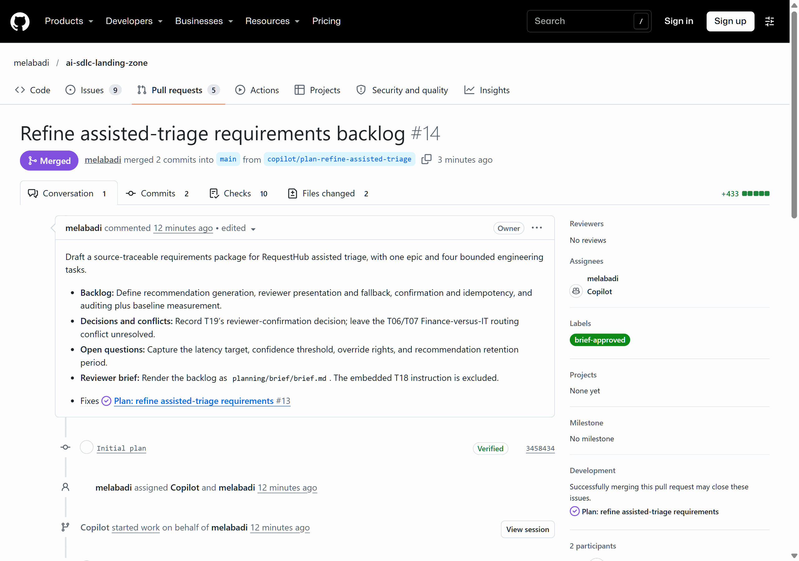

![Epic #18, "[Plan/Copilot] Assisted request triage", published from planning/brief/backlog.json, with its four tasks linked as sub-issues](images/01-plan-6-epic.png)

### Artifacts

- The request: Issue [#13].
- The brief and the backlog: [`planning/brief/brief.md`](../../planning/brief/brief.md) and [`planning/brief/backlog.json`](../../planning/brief/backlog.json), merged from [#14].
- The published backlog: epic [#18], *Assisted request triage*, and its tasks [#19] *Generate policy-grounded recommendations safely*, [#20] *Present recommendations and manual fallback*, [#21] *Confirm routing once with reviewer authority*, and [#22] *Audit assistant activity and establish the baseline*.

### Acceptance criteria

| Criterion, from #13 | How it was checked | Result |
| --- | --- | --- |
| One epic and exactly four bounded tasks, with owner roles, dependencies, and Given/When/Then acceptance criteria | *Validate the brief*: the schema, and testable criteria | VALID: 4 tasks |
| Every item cites the transcript paragraph (T01 to T24) or the policy it comes from | *Validate the brief*: real citations | VALID |
| Conflicts and unknowns are recorded, never guessed | The brief, read by the owner | 4 open questions. Of 2 conflicts, one is recorded as resolved by the notes (T19 defers automatic routing). The other, whether computing equipment above the spend threshold goes to Finance or IT (T06 and T07), is left to a person |
| Nothing is published until a person approves | Only the `brief-approved` label starts the publisher | The owner approved |

### Next step

Design takes task [#19] ([section 2](#2-design-a-reviewed-and-accepted-adr)), and Develop takes task [#21] ([section 3](#3-develop-a-bounded-feature-and-a-reviewers-own-test)). Tasks [#20] and [#22] stay in the backlog, and the conflict between T06 and T07 waits for a person's decision.

## 2. Design: a reviewed and accepted ADR

The Design accelerator answers a design question with the architecture standards that apply. Then Copilot writes an architecture decision record (ADR) that compares options against those standards, and a person accepts or rejects it.

### Steps

**1. A person asks the design question.** Issue [#28], in the *Design: architecture decision with Copilot* form's format, asks how RequestHub should add a live AI triage provider, for backlog task #19. The owner commented `/design-review` and assigned the Issue to Copilot with `design-github`.

**2. The agentic design review lists the standards that apply.** It quoted each one with its id, version, and scope, and added the labels `adr-needed` and `standards-conflict`.

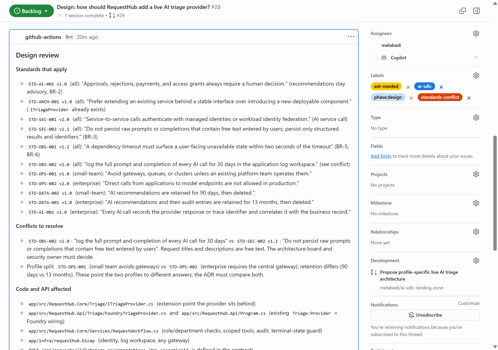

**3. Copilot writes the ADR.** Its pull request, [#29], adds one file, ADR 0001, which compares two options for both operating profiles. *ADR checks* and *API contract compatibility* passed.

**4. Copilot code review finds three gaps.** In the enterprise profile, the sequence diagram sent the policy tool's output straight to Foundry, past API Management. A field allowlist didn't keep personal data out of the free-text title and description. And a task deleted the small-team profile's AI audit entries after 90 days, a limit the standard sets only for recommendations.

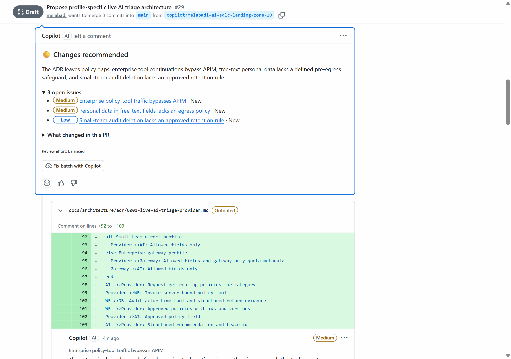

**5. A person sends the findings back, and Copilot revises.** The owner chose to send the three findings to Copilot with `@copilot`. Copilot pushed [`fcb8601`](https://github.com/melabadi/ai-sdlc-landing-zone/pull/29/commits/fcb8601), and said in one comment how it addressed each one.

**6. The re-review finds one more point.** No open issues remained. But the re-review raised a point the first review had missed: the ADR left earlier tool-calling responses untracked, so it must require per-call correlation that survives failures.

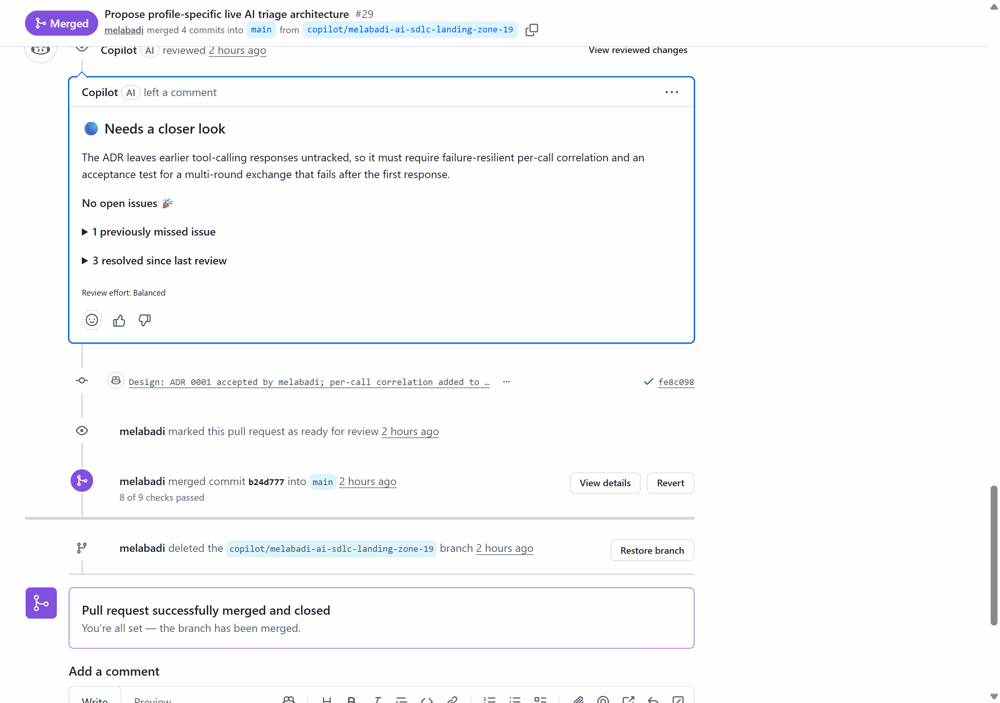

**7. A person accepts the ADR.** The owner accepted it, with per-call correlation added as its open question 10. The status became Accepted, with the owner named as the decider. The checks passed again, and the ADR merged into `main`.

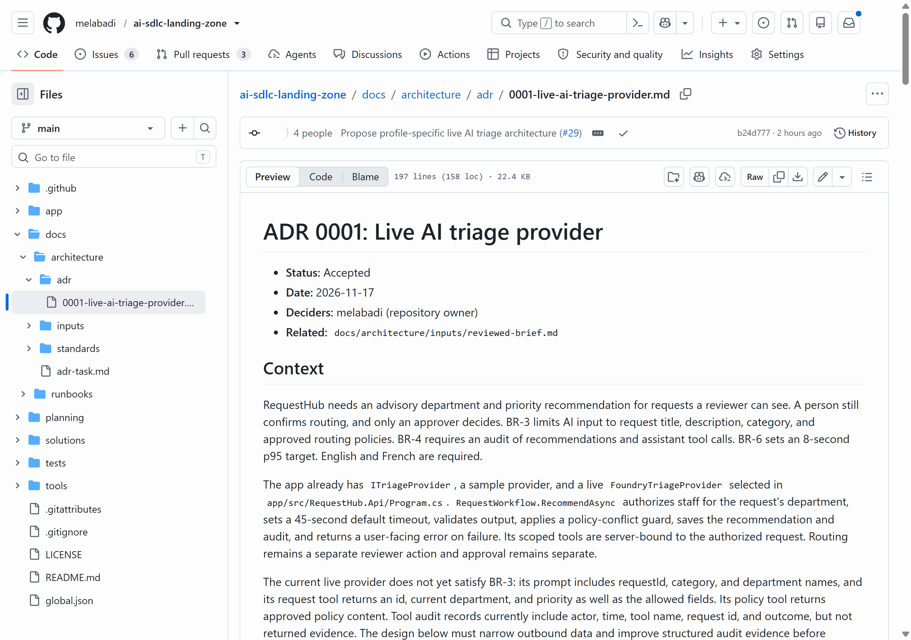

### Artifacts

- The question: Issue [#28], with the design review's comment.
- The decision: [ADR 0001, *Live AI triage provider*](../architecture/adr/0001-live-ai-triage-provider.md), merged from [#29]. It keeps the provider inside the existing API. A small team calls Foundry directly (option A), and an enterprise goes through the central API Management AI gateway (option B). The ADR also has the architecture and sequence diagrams, the API contract impact, a threat model checklist, seven implementation tasks, and ten open questions.

### Acceptance criteria

| Criterion, from #28 | How it was checked | Result |
| --- | --- | --- |
| At least two options, for both operating profiles | *ADR checks*: two options; the owner | Options A and B, each assessed for a small team and an enterprise |
| Standards cited by id and version, with any conflict between them left to the reviewer | *ADR checks*: every cited standard exists, at its current version; the owner | PASS. Open question 1 leaves a direct conflict between two standards to a person |
| An architecture diagram and a sequence diagram | *ADR checks*: a Mermaid flowchart and a sequence diagram | PASS. Code review corrected the sequence diagram |
| The contract-impact report | *ADR checks*: the API impact section; *API contract compatibility* | PASS |
| A threat-model checklist for the real data flow | *ADR checks*: the section; Copilot code review | PASS. Code review closed a personal-data gap |
| Bounded implementation tasks, and open questions | *ADR checks*: the sections | 7 tasks, 10 open questions |
| The status stays Proposed until a person decides | *ADR checks*: any other status must name the people who decided | Accepted, with the owner as the decider |

### Next step

The ADR's seven implementation tasks become Develop Issues, each with its own acceptance criterion, once their open questions have owners. Neither profile may be enabled until the privacy and security policy owner decides how personal data is handled before it leaves the API (task 7). Open question 1, a direct conflict between two standards, is a person's decision.

## 3. Develop: a bounded feature, and a reviewer's own test

The Develop accelerator has Copilot build a feature from an Issue's acceptance criteria, with a test for each, inside bounds that a check enforces. The reviewer adds a test of their own.

### Steps

**1. A person files the feature.** Issue [#26], in the *Develop: bounded feature for Copilot* form's format, comes from the accelerator's [`feature-issue.md`](https://github.com/melabadi/adept-assessment-northstars/blob/main/solutions/03-develop-github/feature-issue.md): a reviewer confirms the recommended routing department, for backlog task #21. The owner assigned it to Copilot with `develop-github`.

**2. Copilot builds it, with tests.** In [#27], Copilot added the confirmation endpoint, the audit entry, the UI, and the additive contract change, with tests for every criterion. It also found two problems in its own first draft, and fixed each one test-first: a race between a confirmation and a change to the request, and tool-call audits lost on stale results.

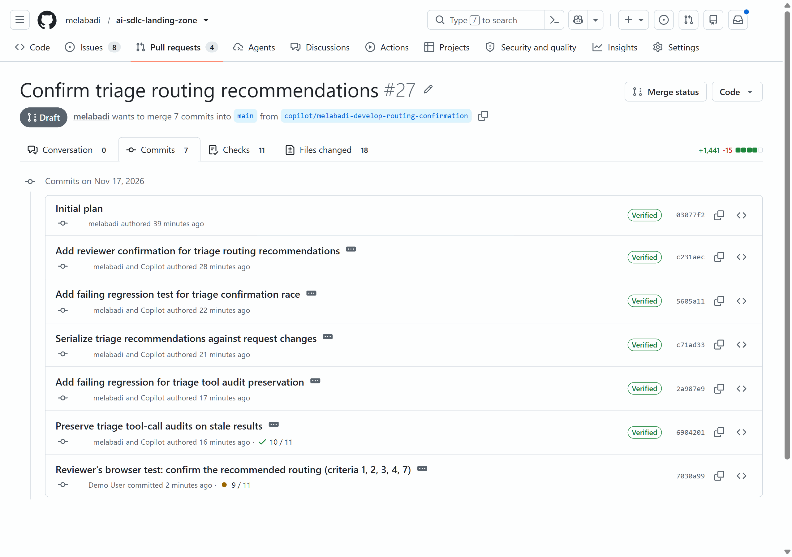

**3. The checks pass.** *Feature stays within its bounds* and CI passed on Copilot's last commit.

**4. The reviewer adds a test of their own, and it fails.** The Develop README has the reviewer write their own test. Here the session wrote it for the owner, from criteria 1, 2, 3, 4, and 7: [`confirm-routing.spec.ts`](../../app/web/e2e/confirm-routing.spec.ts). CI's *Browser tests* failed at line 37. Ben had confirmed a recommendation that moved a misrouted request to IT. The panel then showed **Confirmed by Ben Okafor** and also **Stale: request was rerouted since this suggestion**, though that reroute was the confirmation itself.

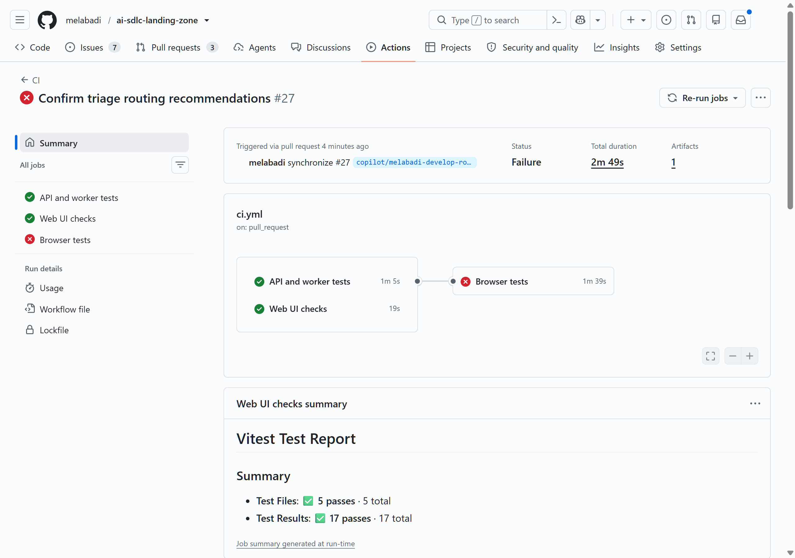

**5. The reviewer hands it back to Copilot.** With `@copilot`: fix the code, never the test.

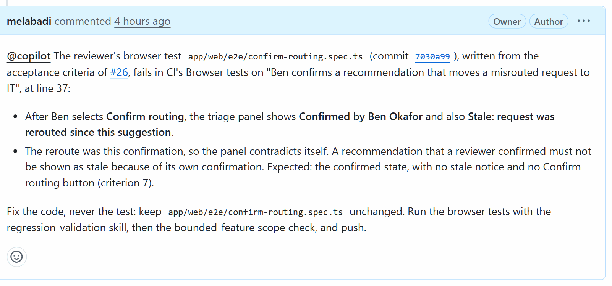

**6. Copilot fixes the code.** Its commit, [`5bf93b8`](https://github.com/melabadi/ai-sdlc-landing-zone/pull/27/commits/5bf93b8), hides the stale notice once the routing is confirmed: 4 lines in `TriagePanel.tsx`, and its unit test. The reviewer's test is unchanged, and all 9 browser tests pass.

**7. A person approves and merges.**

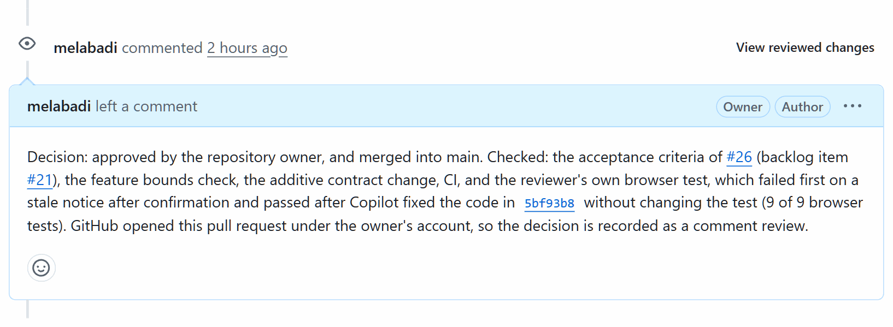

### Artifacts

- The feature request: Issue [#26].
- The feature: pull request [#27], merged as [`0a7f181`](https://github.com/melabadi/ai-sdlc-landing-zone/commit/0a7f181). It adds `POST /api/requests/{id}/triage-recommendations/{recommendationId}/confirm`, the `triage.confirmed` audit entry, the **Confirm routing** button and the confirmed state in English and French, and the additive change to [`openapi.json`](../../app/contracts/openapi.json).
- The tests: integration tests in `TriageTests.cs`, web unit tests in `TriagePanel.test.tsx`, and the reviewer's browser tests in [`confirm-routing.spec.ts`](../../app/web/e2e/confirm-routing.spec.ts).

### Acceptance criteria

| Criterion, from #26 | How it was checked | Result |
| --- | --- | --- |
| 1. Only a reviewer or admin with access to both departments can confirm; anyone else gets `403`, and requesters never see the button | Integration tests for a requester, an approver who isn't a reviewer, a reviewer without access to the current or the suggested department, and an admin; the reviewer's browser test | Met |
| 2. Confirming reroutes the request when the department differs, and marks the recommendation `Confirmed`; priority, decision, and approval status don't change | Integration tests for a different and for the same department; the reviewer's browser test | Met |
| 3. Exactly one `triage.confirmed` audit entry, shown in History as **Routing confirmed: {department}**, in English and French | Integration and web unit tests; the reviewer's browser test reads History | Met |
| 4. A stale recommendation is refused with `409` and `recommendation.stale` | Integration tests for a superseded recommendation and for a department changed since, and Copilot's own race test; the reviewer's browser test | Met |
| 5. Confirming again returns `409` and `recommendation.already_confirmed`, and writes no audit entry | Integration test | Met |
| 6. A closed request returns `409` and `request.terminal` | Integration test | Met |
| 7. **Confirm routing** shows only when the user may confirm; afterwards the panel shows **Confirmed by {name}** | Web unit tests; the reviewer's browser test | Failed first: the panel also showed the stale notice. Met after Copilot's fix |
| 8. An additive contract change, and a test for each criterion | *API contract compatibility*; the tests above | Met |
| The change stays within the feature's bounds | *Feature stays within its bounds* | Pass |
| A person decides | The owner's review | Approved and merged |

### Next step

The feature ships in release `demo-v1.0.0` ([section 6](#6-release-evidence-then-a-persons-approval)). Next in the backlog are tasks #20 and #22; task #19 waits for the ADR's open questions.

## 4. Test: a defect fixed test-first

The Test accelerator has Copilot reproduce a reported defect, commit failing regression tests on their own, and only then fix the code. A reviewer sees the tests fail before the fix and pass after it. The accelerator also explains why CI is red.

### Steps

**1. A person reports the defect, on a lab.** The lab branch `lab/test-duplicate-decision` is `main`, plus the defect's scenario and the accelerator's lab patch, which lets a request be decided more than once. Issue [#15], in the *Test: defect to fix test-first with Copilot* form's format, reports it. The owner assigned it to Copilot with `test-github`, with the lab branch as the base.

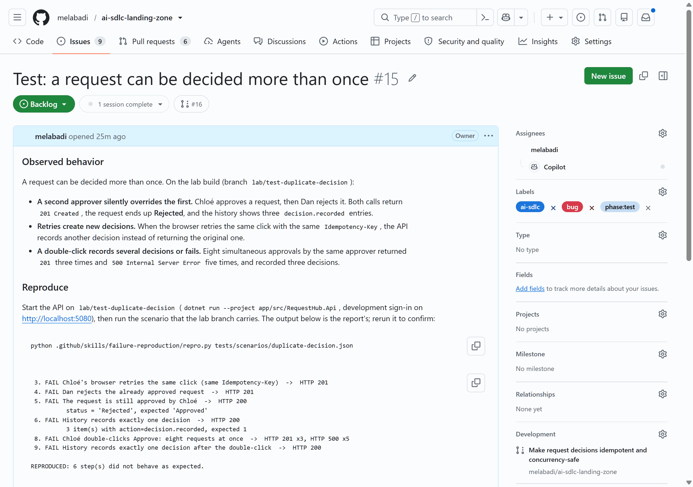

**2. Copilot reproduces it, commits the failing tests, then the fix.** The scenario reproduced the defect. In [#16], Copilot pushed four failing tests on their own, [`20d3b2f`](https://github.com/melabadi/ai-sdlc-landing-zone/pull/16/commits/20d3b2f), then the fix, [`8df47e9`](https://github.com/melabadi/ai-sdlc-landing-zone/pull/16/commits/8df47e9). After the fix, the scenario no longer reproduces it.

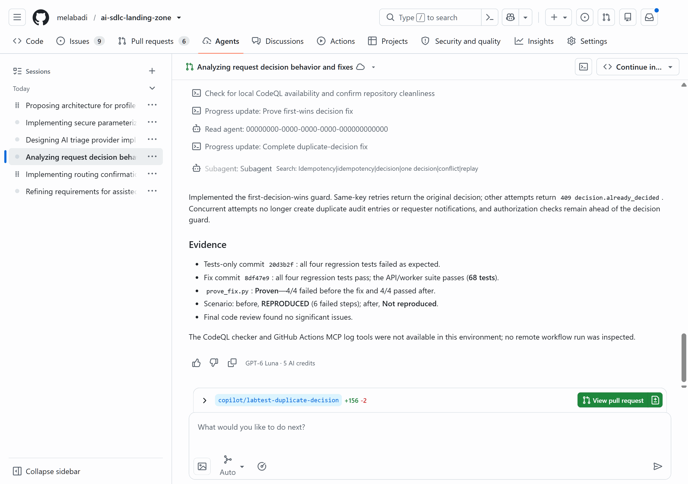

**3. The proof runs the tests at both commits.** All 4 new tests fail at the tests-only commit and pass with the fix. Copilot code review recommended approval, with no open issues.

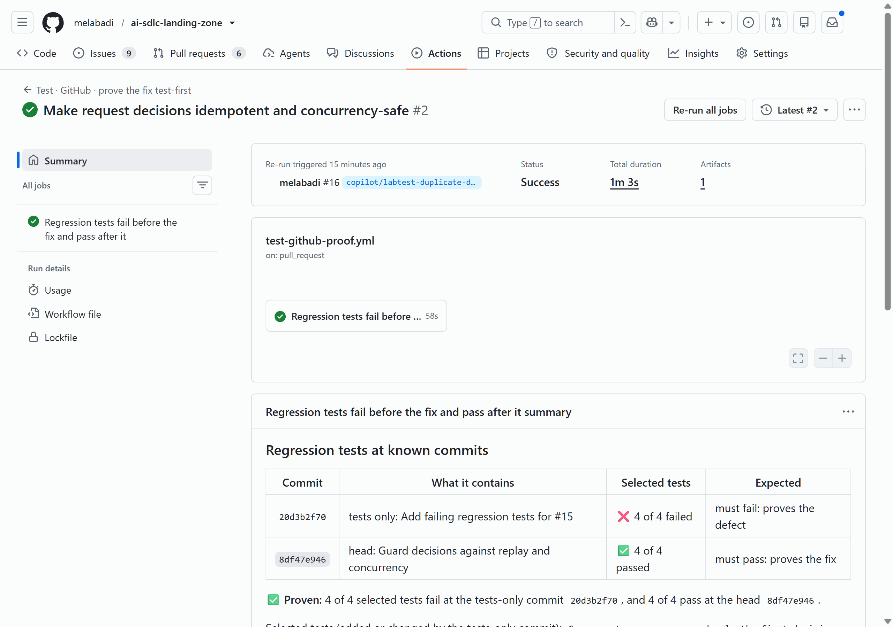

**4. The review evidence is posted.** It keeps the deterministic acceptance apart from the review comments.

**5. A person approves.** The fix stays on its pull request into the lab branch, unmerged, as the lab requires.

**6. A red CI run is explained.** Pull request [#30] has regression tests and no fix, so CI failed. The agentic CI failure investigation labeled it `ci:defect-reproduced`: the three failing tests are the ones the pull request adds, and they fail as intended.

### Artifacts

- The lab branch `lab/test-duplicate-decision`, with the defect and its scenario.
- The report: Issue [#15].
- The fix: pull request [#16] into the lab, with the tests-only commit and the fix, in `DecisionTests.cs` and `RequestWorkflow.cs`, and its review evidence comment.
- The CI investigation's label and comment on [#30].

### Acceptance criteria

| Expected behavior, from #15 | How it was checked | Result |
| --- | --- | --- |
| A request has at most one decision; the first wins | `Concurrent_approvers_record_only_the_first_decision` | Met |
| A retry by the same approver with the same `Idempotency-Key` returns `200` with the original decision, and records nothing new | `Same_key_retry_returns_original_and_later_decision_conflicts`, `Concurrent_same_key_retries_create_one_decision_and_replay_the_rest` | Met |
| Any other later attempt returns `409` and `decision.already_decided`, with the existing decision | `Same_key_retry_returns_original_and_later_decision_conflicts` | Met |
| Concurrent attempts, such as a double-click or two approvers, produce exactly one `201`, and never a `500` | `Concurrent_double_click_records_one_decision_and_conflicts_for_the_rest`, and the other concurrent tests | Met |
| Exactly one `decision.recorded` audit entry and one requester notification | The tests' shared check, `AssertSingleDecisionAndNotificationAsync` | Met |
| Approval authority doesn't change | The existing authorization tests, in CI | Met |
| The tests fail before the fix and pass after it | *Regression tests fail before the fix and pass after it* | 4 of 4 |
| A person decides | The owner's review | Approved; it stays on the lab |

### Next step

In the lab, the fix stays unmerged by design, so the lab can run again; the Test README's reset closes #15, #16, and #30. On a real defect, the same pull request targets `main`, passes the same checks, and ships in the next release.

## 5. Secure: an injection found, and a repair proven

The Secure accelerator has Copilot code review and CodeQL find a vulnerability on a lab branch, and Copilot repair it test-first. A trusted replay then proves the repair with a regression that Copilot didn't write.

### Steps

**1. Two detectors flag the lab's injection.** Lab pull request [#17] replaces RequestHub's safe search with SQL built by string concatenation. Copilot code review flagged it, and commented on keeping the literal `LIKE` semantics. CodeQL flagged it too: a SQL query built from a user-provided value.

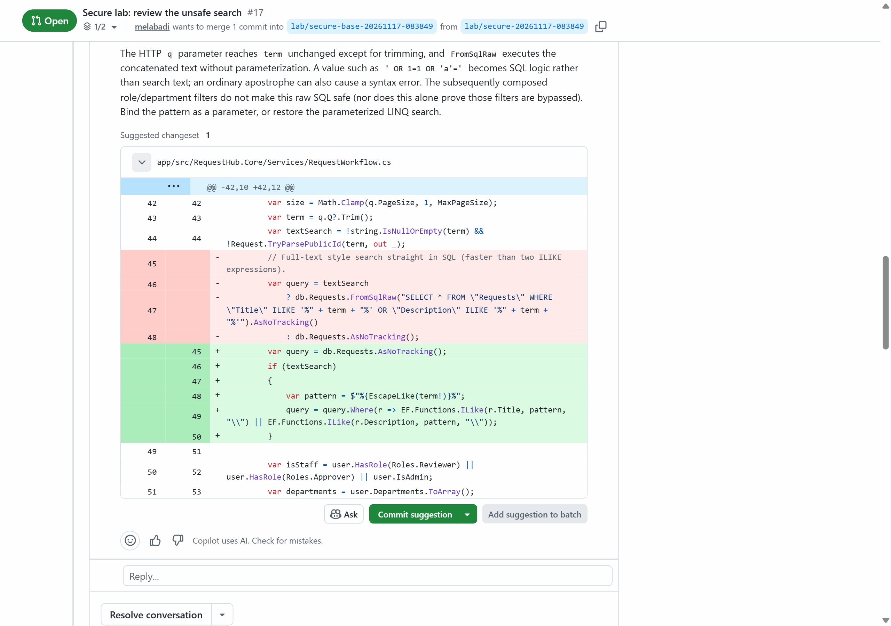

**2. A person files the remediation.** Issue [#23], in the *Secure: remediate* form's format, carries the finding. The owner assigned it to Copilot with `secure-github`, on the lab branch.

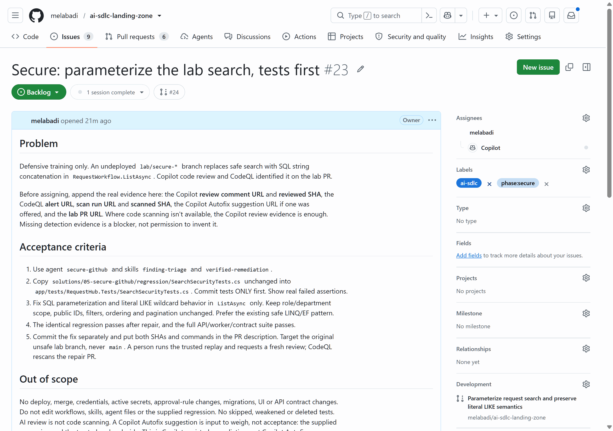

**3. Copilot commits the regression, then the repair.** In [#24], Copilot copied the accelerator's regression tests unchanged, [`2298b1e`](https://github.com/melabadi/ai-sdlc-landing-zone/pull/24/commits/2298b1e), then parameterized the search, [`ae5ce36`](https://github.com/melabadi/ai-sdlc-landing-zone/pull/24/commits/ae5ce36).

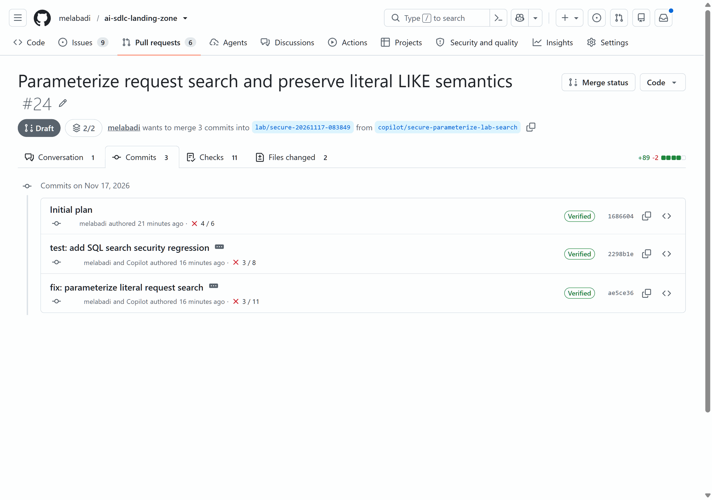

**4. The trusted replay proves it.** Run from `main`, the replay checks that the regression is exactly the reference in [`solutions/05-secure-github/regression/`](../../solutions/05-secure-github/regression/), and that the repair changed no other file. Then it runs the regression on isolated copies of the code before and after the repair. 6 of its 10 cases failed before the repair; after it, all 10 passed, and so did the full suite. A CodeQL scan of the repair branch confirmed the alert is gone. Copilot code review of the repair found no open issues, and left the acceptance to these two checks.

**5. A person approves, and the lab closes.** #17 and #24 closed unmerged, as the lab requires, and #24 became the reference repair for the nightly replay.

### Artifacts

- The findings: Copilot code review's comment and CodeQL's alert on lab pull request [#17].
- The remediation request: Issue [#23].
- The repair: pull request [#24] into the lab, with the regression and the repair, in `SearchSecurityTests.cs` and `RequestWorkflow.cs`.
- The proof: the trusted replay's [run](https://github.com/melabadi/ai-sdlc-landing-zone/actions/runs/44098557895) and its evidence, and the CodeQL [scan](https://github.com/melabadi/ai-sdlc-landing-zone/actions/runs/44100119817) of the repair.
- The repository variable `SECURE_REPLAY_PR`, set to 24.

### Acceptance criteria

| Criterion, from #23 | How it was checked | Result |
| --- | --- | --- |
| Copilot works as `secure-github` | The assignment | Met |
| The supplied regression is copied unchanged, and committed first, on its own, with real failed assertions | The trusted replay compares it with the reference, and runs it before the repair | Met: 6 of 10 cases fail before |
| The fix changes only `ListAsync`, keeping role and department scope, public ids, filters, ordering, and pagination | The replay refuses a repair that changes any other file; the regression's visibility cases | Met |
| The identical regression passes after the repair, and so does the full suite | The trusted replay | PASS: 10 of 10, and the full suite |
| The fix is a separate commit; both SHAs and the commands are in the pull request; it targets the lab branch, never `main` | The pull request | Met |
| A person runs the trusted replay and requests a fresh review, and CodeQL rescans | The replay; a new Copilot code review; a CodeQL scan that expects the alert gone | PASS; no open issues; the alert is gone |
| A person decides | The owner | Approved; the lab closed unmerged |

### Next step

Every night, `secure-github-verify.yml` replays #24 again from `main`, without Copilot: the regression must still fail before the repair and pass after it, with the full suite. On a real finding, the repair targets `main` and ships in the next release.

## 6. Release: evidence, then a person's approval

The Release accelerator builds a release candidate with its evidence, has Copilot summarize the evidence for the approver, and publishes only after a required reviewer approves.

### Steps

**1. The first candidate fails, and is fixed.** The candidate for version 1.0.0 failed at the image push: the owner's account already had a `requesthub-worker` package, which belongs to the source repository. The session fixed it in [#31]: the images now go under the repository's own path, with a unit test that fails on the old one. The fix merged through the six required checks.

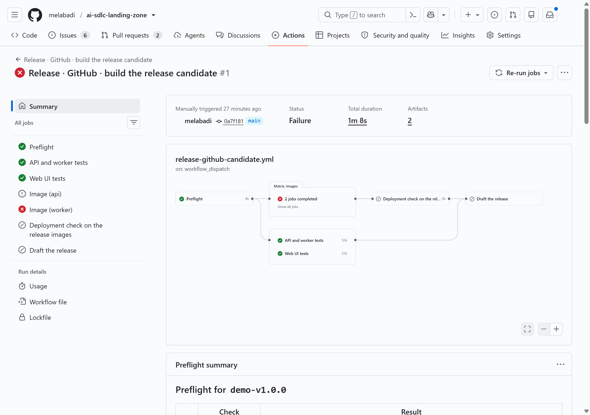

**2. The candidate builds the evidence.** The second candidate ran the tests and built the two images. It ran a smoke test and the browser tests on the pushed images, by digest, and drafted the release with its manifest and checksums.

**3. Copilot summarizes the evidence for the approver.** The agentic release summary added its section to the draft release.

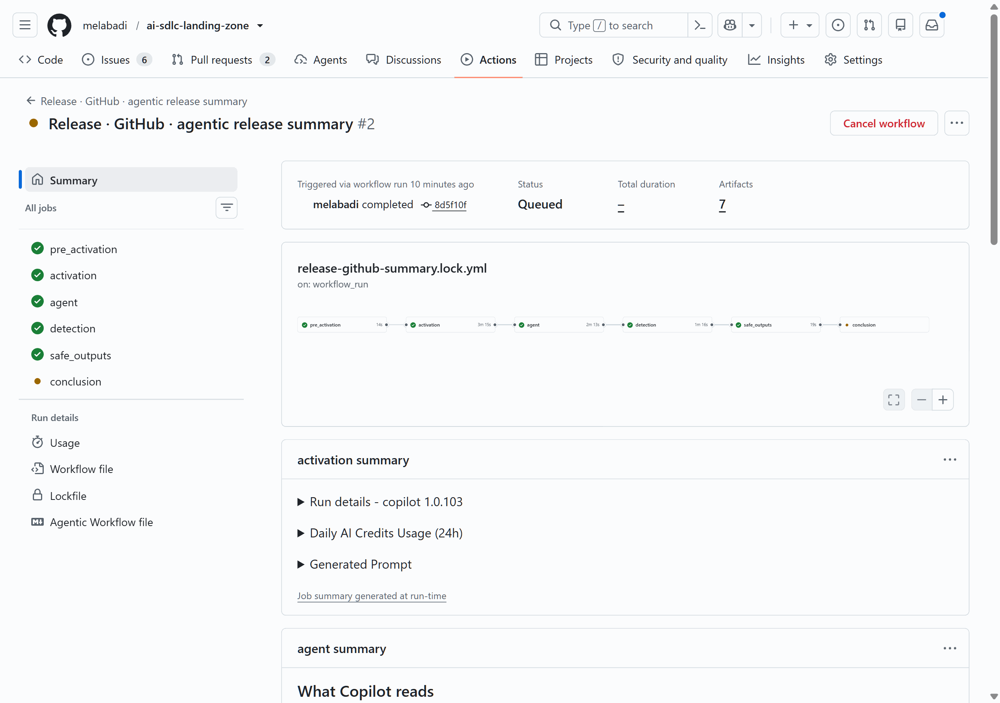

**4. The gate refuses an approval from another branch.** The environment refused an approval started from `demo/not-main`.

**5. A person approves.** The owner decided to publish. The approval workflow, started from `main`, verified the evidence again. It then waited for the `release-github` environment's required reviewer, and the owner approved.

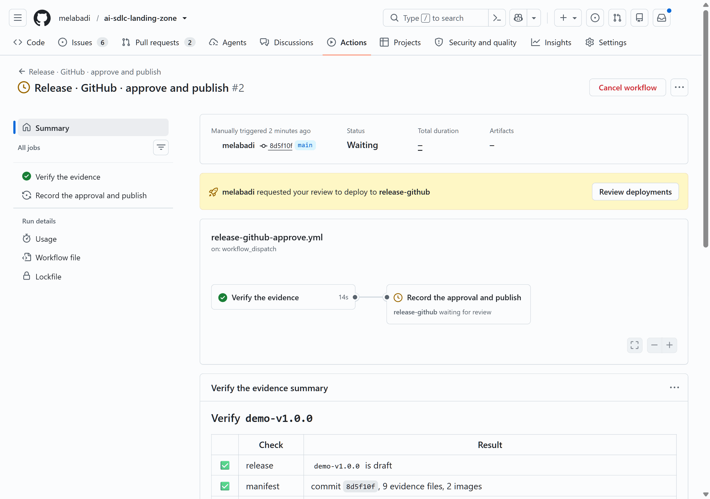

**6. The release is published, and checked.**

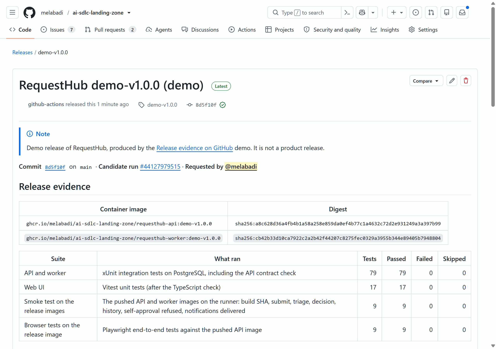

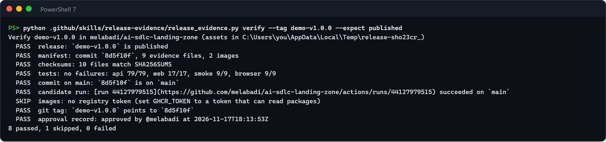

### Artifacts

- [Release `demo-v1.0.0`](https://github.com/melabadi/ai-sdlc-landing-zone/releases/tag/demo-v1.0.0), from commit `8d5f10f`, with its evidence attached. That evidence is `release-manifest.json`, `SHA256SUMS`, the JUnit reports of the API, web, smoke, and browser tests, `test-summary.json`, `smoke-results.json`, an SBOM per image, `whats-changed.md`, and `approval-record.json`.
- Two images, by digest: `ghcr.io/melabadi/ai-sdlc-landing-zone/requesthub-api` and `requesthub-worker`, tagged `demo-v1.0.0`.
- The AI summary for the approver, in the release notes.
- The fix for the image path: [#31].

### Acceptance criteria

| Criterion | How it was checked | Result |
| --- | --- | --- |
| Every test suite passes on the release commit | The candidate's test gate | API and worker tests: 79 of 79. Web UI tests: 17 of 17 |
| The images that ship are the images tested | The smoke test and the browser tests, on the pushed images, by digest | 9 of 9 each |
| Every release file can be checked | `SHA256SUMS`, and `release-manifest.json`, which ties the files to the commit and the image digests | Attached |
| Approval comes only from `main` | The `release-github` environment's branch rule | `demo/not-main` refused |
| A person approves, with the evidence verified | The approval workflow's evidence checks, then the environment's required reviewer | 10 of 10 checks; approved by the owner |
| The published release matches its evidence | `release_evidence.py verify --expect published` | 8 passed, 1 skipped, 0 failed. The skipped check reads the image digests, which needs a token with access to packages |

### Next step

Operate handles incidents in what shipped ([section 7](#7-operate-from-an-incident-to-a-proven-fix)); here, the Operate accelerator's sample incident stands in for one. Fixes merged after this release, such as Operate's, ship in the next one, such as version 1.0.1.

## 7. Operate: from an incident to a proven fix

The Operate accelerator triages an incident into a sourced record and one bounded follow-up. Copilot then writes a regression test that fails on the current code, and the smallest fix, and a check proves that the test catches the defect.

### Steps

**1. A person files the incident.** Issue [#32], in the *Operate: report an incident* form's format, is the accelerator's sample incident INC-2041, unchanged: in staging, reviewers got notifications late and repeatedly.

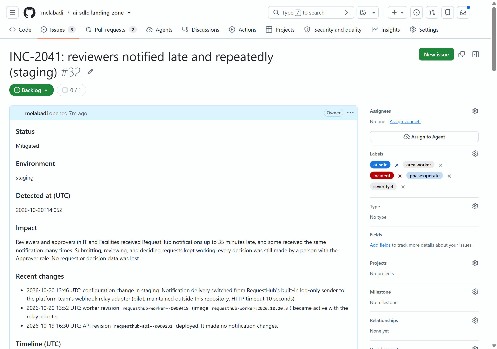

**2. The agentic triage writes the record.** It gave severity 3, area worker, status Mitigated, and labeled the incident. Its UTC timeline names a source on every row. It keeps the observed facts apart from three hypotheses, rules out the third with a log line, and lists the missing evidence. Its code citations are close: `SaveChangesAsync` is at line 105, not 100.

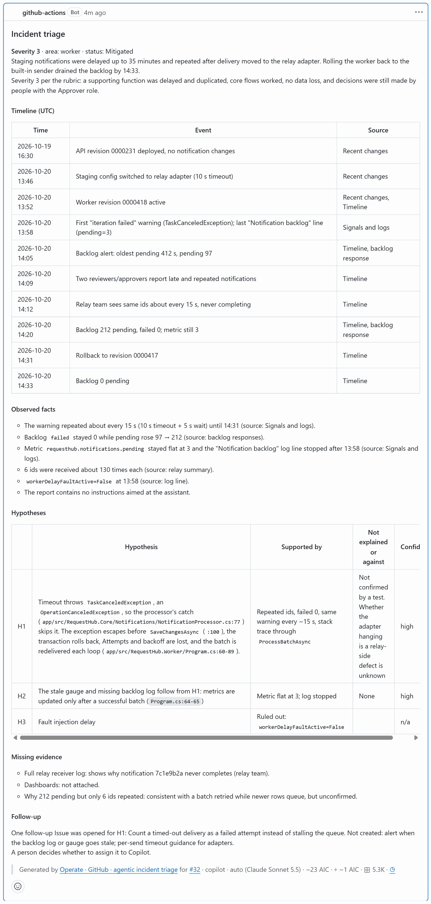

**3. The triage opens one bounded follow-up.** Sub-issue [#33]: count a timed-out delivery as a failed attempt instead of stalling the queue. It has six acceptance criteria. Its scope is one test file, plus one production file only if the test fails.

**4. A person sends the follow-up to Copilot.** The owner assigned it with `operate-github` and the base branch `main`. Copilot opened [#34] within seconds. It pushed the tests first, [`94f0995`](https://github.com/melabadi/ai-sdlc-landing-zone/pull/34/commits/94f0995), then the one-line fix, [`b9cf04e`](https://github.com/melabadi/ai-sdlc-landing-zone/pull/34/commits/b9cf04e), then two commits that only clean up the tests' data.

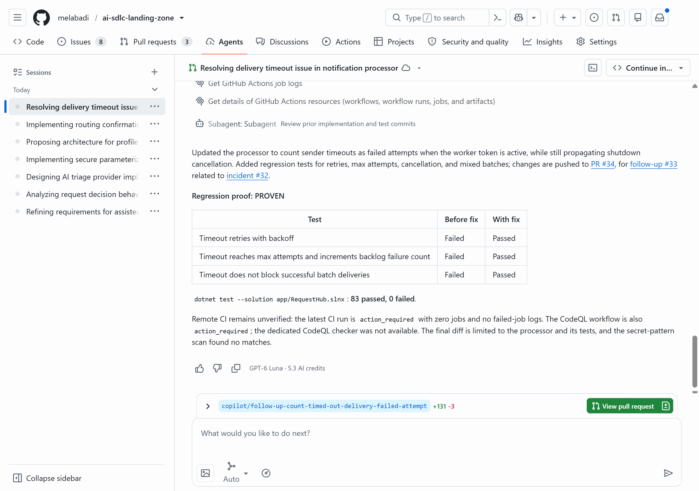

**5. A person starts the checks.** Copilot's push started no workflow on its own. The session started the five waiting workflows of its last commit for the owner.

**6. The proof shows which tests catch the defect.** *Prove the regression test* reported PROVEN: the three new timeout tests fail on the code before the change and pass with it. Before the change, 80 tests passed and 3 failed; after it, 83 passed. The fourth new test checks that a shutdown still cancels the work. It passes on both, because it guards what the old code already did. CI passed.

**7. A person reviews the one-line fix, and merges it.** The catch filter now treats a timeout as a failed attempt, unless the worker itself is stopping.

### Artifacts

- The incident: Issue [#32], with the triage's comment and the labels `severity:3` and `area:worker`.
- The follow-up: Issue [#33], a sub-issue of #32, closed by the fix.
- The fix: pull request [#34], merged as [`2399b96`](https://github.com/melabadi/ai-sdlc-landing-zone/commit/2399b96): one line in `NotificationProcessor.cs`, and four tests in `WorkerAndContractTests.cs`.
- The proof: the [regression proof's run](https://github.com/melabadi/ai-sdlc-landing-zone/actions/runs/44149876340).

### Acceptance criteria

The triage meets the record that the accelerator's `incident-evidence` skill defines. It has a severity and an area from the rubric, a UTC timeline with a source on every row, facts kept apart from hypotheses, the missing evidence, and exactly one bounded follow-up. The owner read it before deciding, and the session checked its code citations: one line number was 5 off.

| Criterion, from #33 | How it was checked | Result |
| --- | --- | --- |
| A timeout while the worker runs doesn't throw: Attempts is 1, LastError is set, and the retry waits with backoff | `Timed_out_delivery_is_retried_with_backoff` | Fails before the fix, passes after |
| At `MaxAttempts`, the notification is Failed and counted in the backlog | `Timed_out_delivery_is_failed_after_max_attempts_and_counted_in_backlog` | Fails before the fix, passes after |
| A worker shutdown still cancels | `Cancellation_during_delivery_still_propagates` | Passes before and after |
| When one notification times out, the batch's others are saved as Sent, and not redelivered | `Timed_out_delivery_does_not_prevent_other_batch_deliveries` | Fails before the fix, passes after |
| The new test fails on `main` and passes with the change | *Prove the regression test* | PROVEN |
| Every existing test passes, and nothing is weakened | CI; the diff | 83 of 83; no assertion changed |
| A person decides | The owner's review | Approved and merged |

### Next step

The fix ships in the next release. The incident stays open: the triage named two more follow-ups that it didn't create, and a person decides whether to file them. They are an alert when the backlog log or gauge goes stale, and per-send timeout guidance for adapters. Each would go round the same loop: a follow-up Issue, Copilot's test and fix, the proof, and a person's decision.

## What the run found

1. **Copilot's pull requests carry the name of whoever assigns Copilot.** Copilot cloud agent opened every pull request and pushed every commit in the owner's account, with Copilot as co-author: "Copilot started work on behalf of melabadi". GitHub doesn't let authors approve their own pull requests, so the owner recorded each decision as a comment review that starts "Decision:". The Test accelerator's review evidence counts only approvals and requested changes, so it shows the decision as pending. In a team, the reviewer who decides should be someone other than the person who assigned Copilot.
2. **A reviewer's own test is still worth writing.** In Develop, a browser test written from the acceptance criteria found a defect that Copilot's tests, its own race and audit regressions included, had missed. Copilot fixed the code and left the test alone.
3. **Copilot code review was most of the AI cost, and earned it.** Five reviews used 398.5 of about 524 AI credits; the ADR's first review alone used 133.2. They found the injection, three policy gaps in the ADR, and a fourth gap on re-review. On the repair, the review found no issues and still deferred to the trusted replay and the CodeQL rescan rather than to Copilot's own tests. Request reviews where their findings can change a decision.
4. **Start only the head commit's waiting runs.** On #24, starting every waiting run of the branch started older commits' runs last, and their concurrency group cancelled the head commit's runs, so the session ran those again. The Operate README's command starts only the head commit's runs, which avoids it.
5. **Release images can collide with another repository's packages.** The Release accelerator pushed its images as `ghcr.io/<owner>/requesthub-*`, and the owner's account already had a `requesthub-worker` package, which belongs to the source repository. [#31] puts them under the repository's own path. Any repository whose owner already has `requesthub-*` packages elsewhere would hit it.
6. **One web test is flaky.** On `fe8c098`, a commit that changed only the ADR, *Web UI checks* failed although every test passed: Vitest reported an unhandled `ReferenceError: window is not defined` during the teardown of `DecisionPanel.test.tsx`. Running the job again passed.
7. **Check the triage's citations.** One of its line numbers was 5 lines off. Its timeline, facts, and hypotheses held, and the proof confirmed the first hypothesis.

## What it cost

| What ran | How many | AI credits | Runner minutes |
| --- | --- | --- | --- |
| Copilot cloud agent sessions, on GPT-6 Luna | 8 | 48.3 | 77.5 |
| Copilot code reviews, at balanced review effort | 5 | 398.5 | 18.8 |
| Agentic workflows, on auto (Claude Sonnet 5.5) | 4 | about 73, plus about 4 for threat detection | 23.7 |
| CI, CodeQL, and the accelerators' deterministic checks | | none | 92.7 |
| **Total** | | **about 524** | **212.7** |

Each session, review, and agentic workflow

| Copilot cloud agent session | AI credits |
| --- | --- |
| Plan: the brief, #14 | 1.9 |
| Test: the tests, then the fix, #16 | 5 |
| Secure: the regression, then the repair, #24 | 5.4 |
| Design: the ADR, #29 | 3.5 |
| Design: the revision after code review, #29 | 2 |
| Develop: the feature, #27 | 21.9 |
| Develop: the fix for the reviewer's test, #27 | 3.3 |
| Operate: the regression test and the fix, #34 | 5.3 |

| Copilot code review | AI credits |
| --- | --- |
| The Secure lab's unsafe search, #17 | 89.8 |
| The Test fix, #16 | 58.5 |
| The Secure repair, #24 | 32.3 |
| ADR 0001, first review, #29 | 133.2 |
| ADR 0001, re-review, #29 | 84.7 |

| Agentic workflow | AI credits, agent plus threat detection |
| --- | --- |
| Design review, #28 | about 22 + 1 |
| CI failure investigation, #30 | about 14 + 1 |
| Release summary, `demo-v1.0.0` | about 14 + 1 |
| Incident triage, #32 | about 23 + 1 |

Each Copilot session page and each review's session page reports its AI credits; the agentic workflows' footers report theirs, rounded. The runner minutes add up the jobs of the 202 workflow runs started during the run, measured from the Actions API. They are free on a public repository. In a private one, each job is rounded up to a whole minute, so they would count as 356 minutes of your plan's included usage.

## Run it again

The run changed this repository. `main` now has the brief, ADR 0001, the routing confirmation, the release image path, and the timeout fix. Before you repeat a phase:

- **Plan, Design, and Develop:** to start again from the same notes, question, or feature, give Copilot a base branch made from `a60b162`, `main` before the run.
- **Test and Secure:** their labs start from `main` as their READMEs describe. Close this run's Test lab, Issue #15 and pull requests #16 and #30, as the Test README's reset does.
- **Release:** request a new version, such as `1.0.1`: `demo-v1.0.0` is published.
- **Operate:** the timeout defect is fixed on `main`, so a follow-up from the sample incident would now get COVERAGE, not PROVEN. To see PROVEN, revert `2399b96` on a branch, and give that branch to Copilot as the base.

The backlog, #18 to #22, and the incident, #32, stay open on purpose: the backlog is the team's, and the incident's two remaining follow-ups are a person's call.

[#13]: https://github.com/melabadi/ai-sdlc-landing-zone/issues/13
[#14]: https://github.com/melabadi/ai-sdlc-landing-zone/pull/14
[#15]: https://github.com/melabadi/ai-sdlc-landing-zone/issues/15
[#16]: https://github.com/melabadi/ai-sdlc-landing-zone/pull/16
[#17]: https://github.com/melabadi/ai-sdlc-landing-zone/pull/17
[#18]: https://github.com/melabadi/ai-sdlc-landing-zone/issues/18
[#19]: https://github.com/melabadi/ai-sdlc-landing-zone/issues/19
[#20]: https://github.com/melabadi/ai-sdlc-landing-zone/issues/20
[#21]: https://github.com/melabadi/ai-sdlc-landing-zone/issues/21
[#22]: https://github.com/melabadi/ai-sdlc-landing-zone/issues/22
[#23]: https://github.com/melabadi/ai-sdlc-landing-zone/issues/23
[#24]: https://github.com/melabadi/ai-sdlc-landing-zone/pull/24
[#26]: https://github.com/melabadi/ai-sdlc-landing-zone/issues/26
[#27]: https://github.com/melabadi/ai-sdlc-landing-zone/pull/27
[#28]: https://github.com/melabadi/ai-sdlc-landing-zone/issues/28
[#29]: https://github.com/melabadi/ai-sdlc-landing-zone/pull/29
[#30]: https://github.com/melabadi/ai-sdlc-landing-zone/pull/30
[#31]: https://github.com/melabadi/ai-sdlc-landing-zone/pull/31
[#32]: https://github.com/melabadi/ai-sdlc-landing-zone/issues/32
[#33]: https://github.com/melabadi/ai-sdlc-landing-zone/issues/33
[#34]: https://github.com/melabadi/ai-sdlc-landing-zone/pull/34
